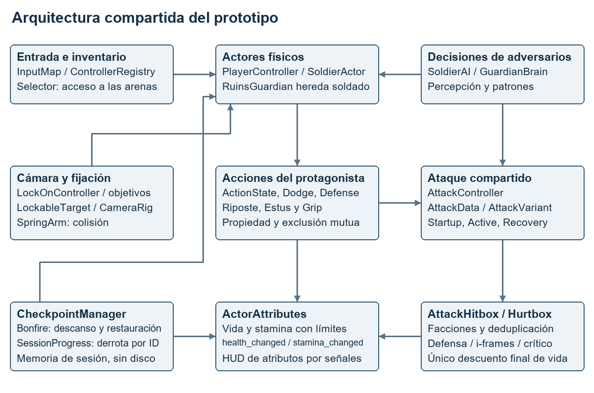
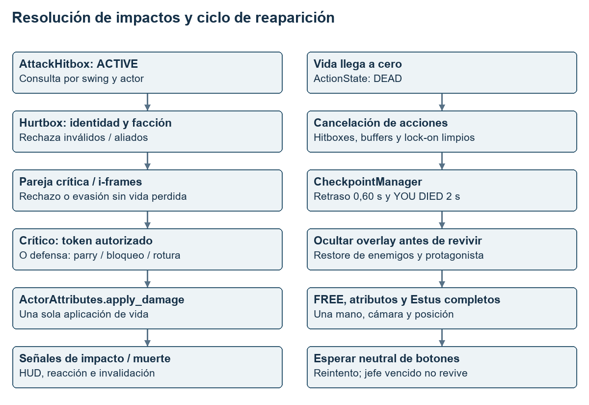
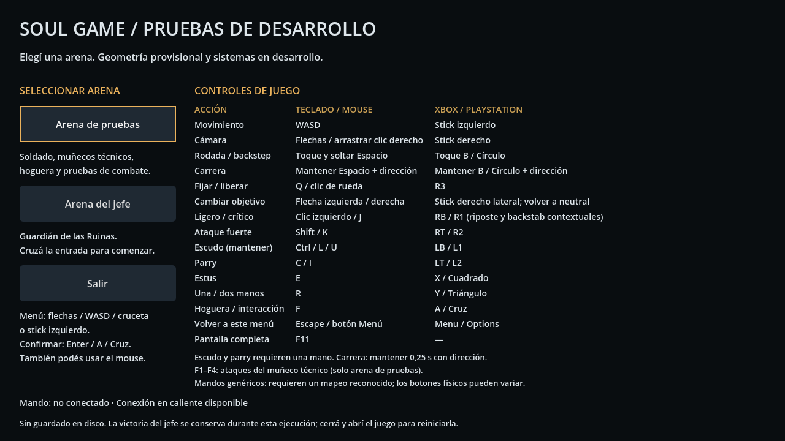
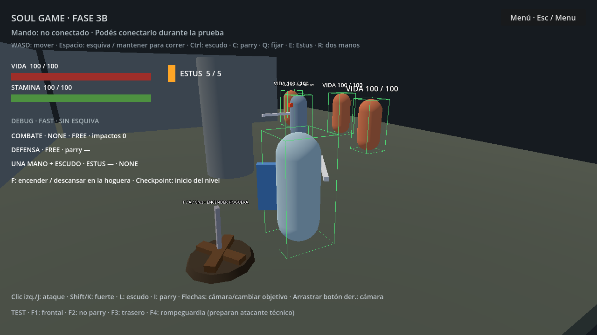
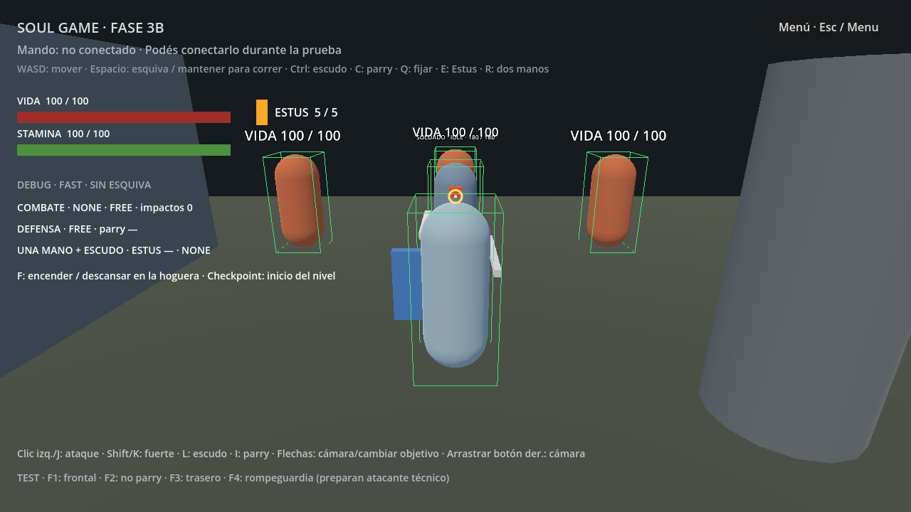
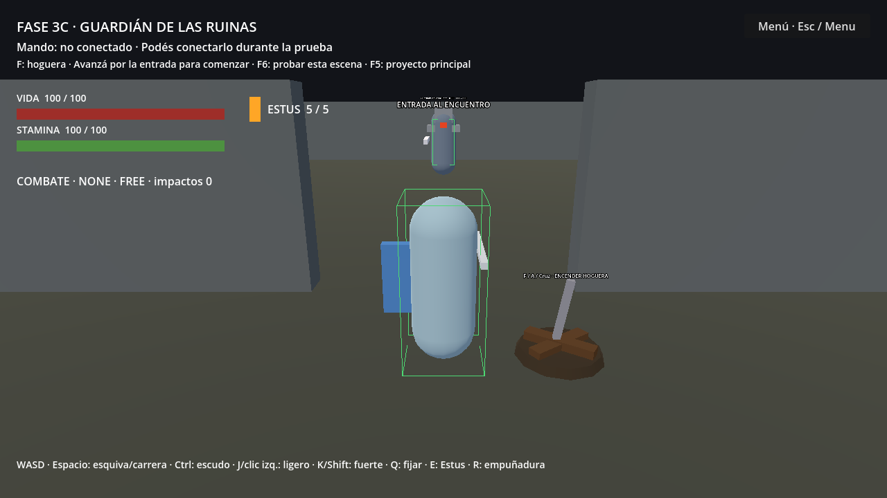
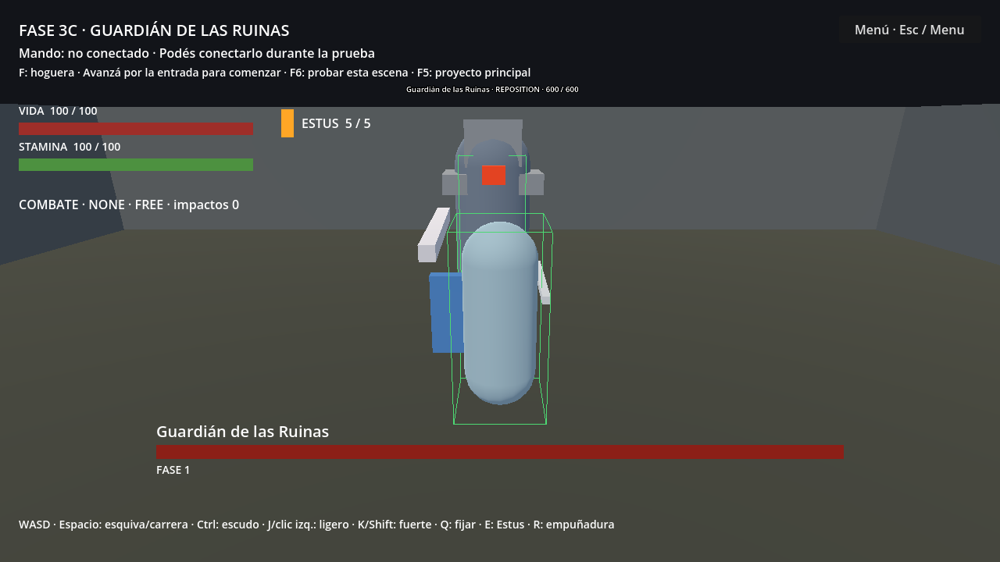
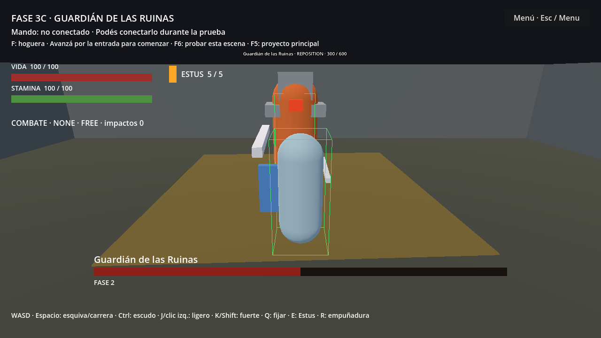

# Desarrollo de un videojuego Soulslike 3D

## Informe parcial de desarrollo

**Institución:** Escuela Técnica N.º 3 de Benavídez  
**Especialidad:** Informática  
**Ciclo lectivo:** 2026  
**Fecha del informe:** 7 de noviembre de 2026  
**Exposición prevista:** 17 de noviembre de 2026

**Nombre definitivo del proyecto:** [Completar]  
**Integrantes:** [Completar]  
**Curso y división:** [Completar]  
**Docente/s:** [Completar]

**Corte del informe:** funcionalidades desarrolladas hasta la Fase 3C. La Fase 4A no comenzó. Se incluye el selector temporal de arenas como utilidad de presentación añadida posteriormente, sin considerarlo una fase nueva.

<!-- pagebreak -->

## Índice

1. Introducción y contexto
2. Objetivos y alcance
3. Método de auditoría y criterios de evidencia
4. Tecnologías y organización del trabajo
5. Arquitectura del prototipo
6. Desarrollo por fases
7. Mecánicas y funcionamiento técnico
8. Pruebas y validación
9. Dificultades técnicas documentadas
10. Estado actual y tareas pendientes
11. Evidencia gráfica
12. Conclusión
13. Referencias
14. Datos a completar antes de presentar

El PDF incorpora un índice con números de página. Los detalles de archivos, APIs y resultados se amplían en ANEXO_TECNICO.md. RESUMEN_EXPONER.md contiene una propuesta de exposición oral.

<!-- pagebreak -->

## 1. Introducción y contexto

Un soulslike es un videojuego de acción en el que la administración de recursos, la observación de los adversarios y el compromiso de cada acción son elementos centrales del combate. En este proyecto, la referencia de diseño es Dark Souls 1: desplazamiento deliberado, cámara en tercera persona, fijación de objetivos, stamina, defensa y oportunidades de ataque. Esta referencia no implica que se hayan reproducido exactamente sus tiempos, animaciones o dificultad.

El proyecto propone un entorno de fantasía medieval oscura. En el corte actual se dispone de un prototipo funcional construido con cápsulas, cajas y otras primitivas. El protagonista puede moverse, combatir, curarse, morir y reaparecer; existe un soldado autónomo y un jefe de dos fases en una arena independiente. La ambientación definitiva todavía no está integrada.

La elección de Godot resulta adecuada para este trabajo por su organización en nodos, escenas y recursos, la integración con GDScript y las herramientas de física y depuración. La configuración Compatibility permite trabajar con una base gráfica sencilla. Estos son criterios técnicos compatibles con el proyecto observado, no una medición que garantice rendimiento en cualquier computadora.

La exposición del 17 de noviembre busca demostrar un proceso de ingeniería: traducir requisitos en componentes, integrar sistemas, verificar reglas y reconocer los límites del prototipo. La demostración prevista incluye movimiento y combate, un ciclo de muerte y reaparición y el encuentro con el jefe, acompañados por evidencia de pruebas.

Según la organización informada por el equipo, el trabajo se divide en programación, arte 3D y música. El repositorio auditado permite verificar principalmente la programación y las escenas provisionales. No permite medir el avance de archivos artísticos o musicales que se encuentren fuera de esta carpeta. Los nombres y las responsabilidades individuales deben completarse por los integrantes.

## 2. Objetivos y alcance

### 2.1 Objetivo general

Desarrollar y documentar un prototipo de videojuego soulslike 3D que integre movimiento, combate y comportamiento de adversarios mediante componentes reutilizables, como aplicación de conocimientos de programación y análisis de sistemas de la especialidad Informática.

### 2.2 Objetivos específicos

| Objetivo | Estado al corte |
|---|---|
| Organizar escenas, scripts y datos configurables sin duplicar responsabilidades. | Alcanzado en el prototipo. |
| Implementar entrada semántica, locomoción analógica, cámara y lock-on. | Implementado; validación física de mandos pendiente. |
| Integrar vida, stamina, estados, ataques, defensa, críticos y curación. | Implementado con representación provisional. |
| Desarrollar un enemigo normal y un jefe de dos fases con combate compartido. | Implementado; ajuste de dificultad pendiente. |
| Resolver muerte, checkpoints, descanso y restauración segura. | Implementado sin guardado entre ejecuciones. |
| Construir evidencia reproducible de pruebas funcionales y regresión. | Informes y resultados disponibles; límites explicitados. |
| Integrar arte, animación y sonido y evaluar la versión de exposición. | Pendiente; Fase 4A no iniciada. |

### 2.3 Alcance actual y versión prevista

El alcance alcanzado comprende dos arenas técnicas, un selector temporal con controles, un protagonista, un soldado activo de IA y un jefe. Se utilizan geometría y HUD de depuración; no existe un nivel completo con progresión. El selector permite acceder a las arenas sin recorrer un escenario definitivo.

La versión prevista incorpora modelos y escenario, animaciones sincronizadas con el combate, tutorial, progresión y audio. También requiere interfaz final, ajuste de dificultad, optimización y exportación Windows validada. Se trata de metas pendientes y condicionadas a la entrega de recursos y a pruebas de integración; no son funciones terminadas.

<!-- pagebreak -->

## 3. Método de auditoría y criterios de evidencia

Se inspeccionaron la estructura del proyecto, project.godot, el README, escenas .tscn, scripts .gd, recursos .tres, el preset de exportación y todos los informes históricos de fases dentro de tests/. Se revisaron responsabilidades, referencias de recursos, métodos de los componentes y archivos JSON de resultados disponibles. La auditoría inventarió 48 scripts de juego; los scripts de pruebas y del complemento de herramientas se consideran por separado.

Se aplicaron tres niveles de evidencia: **código/configuración existente**, **resultado histórico registrado** y **observación actual del motor**. Encontrar un método demuestra que existe una interfaz, pero no acredita por sí solo su comportamiento en todas las condiciones. Las pruebas históricas se describen como tales; no se afirma haber repetido sus suites completas durante esta tarea documental.

Godot AI MCP confirmó Godot 4.6.3-stable oficial, renderizador gl_compatibility y física a 60 ticks por segundo en ejecución. Se arrancaron el selector y ambas arenas sin guardar cambios del editor, se obtuvieron capturas del framebuffer real y se revisaron los logs. Los ajustes para fotografía se hicieron únicamente en memoria y se descartaron al detener el proceso.

La carpeta de esta entrega contiene .gdignore para excluir la documentación del escaneo de recursos de Godot. Se registraron hashes de los archivos del juego, recursos, documentación histórica y configuración antes de generar los documentos, para compararlos al finalizar. No se modificó código, escenas, controles, recursos originales ni informes previos.

Hay información histórica que describe estados anteriores: por ejemplo, varias fases señalan que F5 abre test_arena y que todavía no hay reaparición. En el estado actual F5 abre arena_selector y la reaparición existe desde 3B. Se conserva la trazabilidad temporal en lugar de considerar esas frases antiguas como descripción vigente.

## 4. Tecnologías y organización del trabajo

### 4.1 Herramientas del proyecto

| Tecnología | Función y evidencia |
|---|---|
| Godot 4.6.3 | Motor y editor 3D; escenas, física Jolt, interfaz, señales y ejecución. Versión confirmada por MCP. |
| GDScript | Lenguaje de scripts integrado en Godot, con tipado progresivo. Se utiliza para física, acciones, IA, HUD y pruebas [R1]. |
| Codex | Asistente de programación y documentación. Ayuda a inspeccionar, proponer código y ejecutar verificaciones bajo los requisitos y la supervisión humana. |
| Godot AI MCP | Puente de herramientas hacia el editor y el juego: inspección, ejecución, consultas, eventos simulados y captura de evidencia. Está incluido en addons/godot_ai. |
| Blender | Herramienta declarada para modelado, rigging, animación y optimización del arte. No se encontraron archivos .blend ni modelos importados en esta carpeta. Versión no verificada. |

La intervención humana es central: el equipo define alcance, referencia de diseño, requisitos, arquitectura aceptada, prioridades y criterios de entrega; revisa decisiones, supervisa las pruebas y debe evaluar manualmente la experiencia. El uso de Codex no equivale a afirmar que el juego fue desarrollado de manera autónoma ni que las pruebas automáticas sustituyan esa evaluación.

### 4.2 Configuración y formatos

La base de resolución es 1280 × 720, con ventana redimensionable mediante la configuración existente de interfaz. Se utiliza Compatibility, interpolación física y un objetivo de física de 60 Hz; esos 60 ticks no garantizan 60 imágenes por segundo. El hardware objetivo declarado es Ryzen 7 con gráficos integrados y 4 GB de RAM, todavía sin ensayo de rendimiento.

Los formatos presentes son .gd para scripts, .tscn para escenas, .tres para recursos y .json/.md para resultados y documentación. Los archivos .uid identifican scripts para el editor. Los modelos y materiales provisionales son recursos primitivos definidos dentro de escenas.

Para el intercambio futuro con Blender puede utilizarse glTF 2.0, en .glb o .gltf, formatos documentados por su exportador [R5]. Se los presenta como una alternativa de integración prevista: no hay un flujo de importación de arte definitivo validado en este repositorio. La elección final, la escala, los ejes, el rig y los clips deberán acordarse entre programación y arte.

Existe un preset Windows Desktop x86_64 con recursos incluidos. Su presencia demuestra configuración de exportación, no certifica que se haya generado o probado la distribución final para la escuela. Los metadatos de publicación deben revisarse antes de distribuirla.

<!-- pagebreak -->

## 5. Arquitectura del prototipo

### 5.1 Organización de carpetas y escenas

| Carpeta | Responsabilidad observada |
|---|---|
| scenes/player, enemies, bosses | Escenas reutilizables del protagonista, soldado y jefe. |
| scenes/levels | test_arena y boss_arena; composición de actores, mundo y coordinadores. |
| scenes/props, ui | Cámara, hoguera, muñecos, barras, pantalla de muerte y selector. |
| scripts/player, combat | Control del actor, acciones y componentes de combate compartidos. |
| scripts/enemies, bosses, systems | Decisiones de IA, jefe y servicios de nivel/interfaz. |
| resources | Datos editables de ataques, variantes, esquivas y patrones del jefe. |
| assets | Carpetas reservadas para modelos, animaciones, texturas y audio; sin arte definitivo integrado. |
| tests | Suites GDScript, informes por fase y resultados JSON. |
| addons/godot_ai | Herramientas de desarrollo e integración con el editor. |

La escena principal actual es arena_selector.tscn. Sus referencias PackedScene apuntan a test_arena.tscn y boss_arena.tscn. Cada arena conserva ejecución independiente y una instancia opcional ArenaMenuLink para regresar al selector. No se añadió un servicio global de menús ni se acopló el combate a su controlador.

### 5.2 Componentes y dependencias

PlayerController, sobre CharacterBody3D, conserva la autoridad del movimiento físico. Coordina componentes separados de atributos, disponibilidad de acciones, esquivas, ataques, defensa, críticos, Estus y empuñadura. El estado de locomoción IDLE/WALK/RUN es independiente del estado de acción, que también incluye SWITCHING_GRIP además de FREE, ATTACKING, DODGING, BLOCKING, PARRYING, HEALING, STAGGERED y DEAD.

AttackController recibe solicitudes y datos AttackData/AttackVariant, administra fases y activa AttackHitbox. Hurtbox resuelve el impacto antes de llamar a ActorAttributes.apply_damage. SoldierActor reutiliza esos componentes; SoldierAI decide cuándo moverse y atacar. RuinsGuardian hereda el actor y su escena, reemplazando el cerebro por GuardianBrain; no incorpora un motor de daño paralelo.

LockOnController referencia explícitamente al jugador y CameraRig. Consume objetivos LockableTarget, entrega una base horizontal de movimiento y controla ángulos mediante el modo EXTERNAL del rig. La cámara y el brazo mantienen su propia responsabilidad de seguimiento y colisión.

CheckpointManager pertenece al nivel y coordina hogueras, muerte y restauración por grupos. SessionProgress conserva en la raíz de SceneTree los IDs de jefes derrotados durante la ejecución, sin autoload ni disco. ControllerRegistry es el inventario global de mandos; el otro autoload existente es el helper de Godot AI.

Figura D1. Relaciones principales auditadas. Las flechas representan llamadas, datos o señales según su etiqueta; el diagrama agrupa responsabilidades existentes y no introduce nuevas clases.

<!-- pagebreak -->

## 6. Desarrollo por fases

### 6.1 Fase 1A: estructura, controles y joystick

**Objetivo:** disponer de una base abrible y verificable. **Implementado:** carpetas, escena de prueba, jugador de cápsula, configuración gráfica y acciones de entrada con teclado y mando. **Componentes:** project.godot, player.tscn, test_arena.tscn y ControllerRegistry. **Desafío:** eventos inicialmente limitados al dispositivo 0; se corrigieron a device=-1. El inventario no debe confundir señales sintéticas con hardware. **Pruebas:** 16/16 de configuración, nodos, estabilidad, bindings e inventario. **Estado final:** base técnica validada; compatibilidad física y pantalla completa independiente pendientes de comprobación.

### 6.2 Fase 1B: locomoción

**Objetivo:** desplazamiento deliberado y analógico. **Implementado:** movimiento relativo a cámara, aceleración, frenado, giro visual, gravedad, carrera y estados IDLE/WALK/RUN. **Componentes:** PlayerController y SprintDodgeInput. **Desafío:** conservar toques entre ticks y distinguirlos de pulsaciones largas sin perder señales. **Pruebas:** 44/44 nuevas y 16 regresiones; ocho direcciones, intensidades analógicas, carrera y colisiones. **Estado final:** controlador físico separado de la representación visual, preparado para acciones posteriores; sin equivalencia jugable exacta con Dark Souls.

### 6.3 Fase 1C: cámara orbital

**Objetivo:** sustituir la cámara fija conservando locomoción. **Implementado:** órbita, límites verticales, mouse técnico, suavizado y colisiones. **Componentes:** camera_rig.tscn, orbit_camera.gd y camera_spring_arm.gd. **Desafío:** contracción segura inmediata frente a paredes y recuperación suavizada, sin colisionar con el jugador. **Pruebas:** 38/38 nuevas y 60 regresiones; órbita completa, paredes/columna, exclusión y movimiento a distintos yaw. **Estado final:** jerarquía reutilizable y modo EXTERNAL para control futuro; espacios extremos conservan limitaciones de encuadre.

### 6.4 Fase 1D: lock-on

**Objetivo:** adquisición, cambio y seguimiento de objetivos. **Implementado:** filtros por pantalla, distancia, ángulo y raycasts; marcador, strafe y cancelación por pérdida. **Componentes:** LockOnController, LockableTarget y LockOnIndicator. **Desafío:** el objetivo quedaba tapado por el jugador; se añadió sesgo vertical. Las consultas de tests se sincronizaron con ticks tras mover la cámara. **Pruebas:** 47/47 nuevas y 98 regresiones. **Estado final:** fijación integrada con cámara y locomoción; carrera libera el objetivo; no hay cambio automático al perderlo.

### 6.5 Fase 2A: vida, stamina y estados

**Objetivo:** centralizar atributos y disponibilidad. **Implementado:** consumos seguros, regeneración con retraso, señales, muerte, gasto de carrera e histéresis. **Componentes:** ActorAttributes, ActionState y PlayerVitalsHUD. **Desafío:** separar locomoción de acciones y conservar bloqueos de regeneración independientes. **Pruebas:** 59/59 nuevas y 145 regresiones; límites, valores inválidos, señales, agotamiento y DEAD. **Estado final:** vida/stamina y políticas reutilizables; los estados aún sin mecánicas en esa fase se completaron después.

### 6.6 Fase 2B: rodadas, backstep e invulnerabilidad

**Objetivo:** esquivas comprometidas sin animaciones definitivas. **Implementado:** toque corto al soltar, dirección fija, perfiles por carga, coste y ventanas de i-frames. **Componentes:** DodgeController, DodgeProfile y recursos de esquiva. **Desafío:** garantizar que solo el propietario complete DODGING, incluso desde callbacks. **Pruebas:** 63/63 nuevas y 204 regresiones con aislamientos explícitos del listener corto. **Estado final:** gravedad y colisiones conservadas; backstep e i-frames son parámetros provisionales, no frames originales verificados.

### 6.7 Fase 2C: ataques, combos e impactos

**Objetivo:** combate ofensivo reutilizable. **Implementado:** dos ligeros, fuerte, buffer limitado, fases, hitboxes, hurtboxes y muñecos con vida. **Componentes:** AttackController, AttackData, AttackHitbox, Hurtbox y TrainingDummy. **Desafío:** evitar daño doble por varias hurtboxes o callbacks que cancelan el golpe. Se reservó el actor antes de emitir señales y se detuvo el muestreo al invalidar el ataque. **Pruebas:** 60/60 nuevas y 267 regresiones. **Estado final:** daño funcional; el volumen estático no representa una espada animada.

### 6.8 Fase 2D: bloqueo, parry y riposte

**Objetivo:** defensa resuelta por contacto. **Implementado:** escudo frontal, estabilidad, guard break, parry temporal y ejecución crítica reservada. **Componentes:** DefenseController de combat/, CriticalVulnerability, RiposteController y atacante técnico. **Desafío:** ordenar la resolución antes del único descuento de vida y garantizar un token crítico de un uso. **Pruebas:** 63/63 nuevas y 327 regresiones, con contactos integrados y consultas aisladas. **Estado final:** defensa funcional con geometría; sin partial parry ni resistencias elementales completas.

### 6.9 Fase 2E: backstab, Estus y dos manos

**Objetivo:** ampliar acciones sin duplicar ejecutores. **Implementado:** backstab contextual, curación diferida con cargas y cambio controlado de empuñadura. **Componentes:** RiposteController compartido, EstusController, GripController y AttackVariant. **Desafío:** prioridad contextual, reservas, interrupción antes/después del consumo y snapshots que no mutan recursos fuente. Se corrigió tipado explícito de Dictionary en la selección de perfiles. **Pruebas:** 77/77 nuevas y 390 regresiones. **Estado final:** acciones y HUD funcionales; representación provisional, sin inventario real.

### 6.10 Fase 3A: enemigo normal

**Objetivo:** soldado autónomo capaz de detectar, perseguir, atacar y morir. **Implementado:** percepción con LOS, FSM, espera determinista, reposición, retorno, stagger y combate compartido. **Componentes:** SoldierActor, SoldierAI y soldier_light.tres. **Desafío:** moverse sin atravesar obstáculos mediante probes y colisión real, sin navegación compleja. Una fixture crítica estaba fuera de alcance y se corrigió su colocación. **Pruebas:** 61/61 nuevas, divididas en 14 de componente y 47 integradas; 467 regresiones. **Estado final:** una IA normal funcional; sin búsqueda de rutas alternativas.

### 6.11 Fase 3B: hogueras, muerte y reaparición

**Objetivo:** ciclo reutilizable de descanso y reintento. **Implementado:** registro de hogueras, restauración, YOU DIED, reposición y reinicio de enemigos en su misma instancia. **Componentes:** CheckpointManager, Bonfire, DeathScreen y APIs restore_at_checkpoint. **Desafío:** limpiar acciones/reservas y exigir soltar botones para evitar ataques heredados. Se ajustó el punto inicial para evitar una columna en cámara. **Pruebas:** 62/62 nuevas y 528 regresiones; múltiples muertes/descansos y combate real de la IA. **Estado final:** ciclo funcional, sin guardado permanente.

### 6.12 Fase 3C: jefe de dos fases

**Objetivo:** encuentro diferenciado, transición y victoria. **Implementado:** Guardián de las Ruinas, tres patrones base, ataque de área de fase 2, selección ponderada, HUD y reinicio. **Componentes:** RuinsGuardian, GuardianBrain, BossPattern, EncounterEntry, BossHUD y SessionProgress. **Desafío:** diferir transición hasta terminar el patrón comprometido, limpiar hitboxes y conservar derrota sin duplicar el jefe. Dos fixtures se corrigieron por tiempos de recovery e historial de patrones. **Pruebas:** 73/73 nuevas y 590 regresiones. **Estado final:** encuentro funcional y repetible, sin animaciones ni ajuste final de dificultad.

<!-- pagebreak -->

## 7. Mecánicas y funcionamiento técnico

### 7.1 Entrada, locomoción y orientación

InputMap define 20 acciones requeridas y toggle_fullscreen, con equivalencias de teclado y mando. El controlador consume nombres como move_forward o light_attack, no índices físicos. ControllerRegistry escucha conexión/desconexión y publica nombres, IDs y estado de mapeo; no implementa un remapeador completo ni garantiza índices universales para mandos genéricos.

Input.get_vector aplica deadzone circular y limita la longitud diagonal. PlayerController proyecta el frente de la cámara sobre XZ, lo normaliza y obtiene su perpendicular horizontal. Con entrada (x,y), la dirección combina derecha por x y frente por -y. Así, mirar hacia arriba no reduce la velocidad y la diagonal no supera la magnitud máxima. Sobre esa dirección se aplica velocidad proporcional a la entrada [R2, R3].

La marcha máxima inicial es 3,2 m/s y la carrera 6 m/s; aceleración 14 m/s² y desaceleración 20 m/s². Son parámetros editables. El cuerpo integra gravedad y llama a move_and_slide; el nodo Visual gira gradualmente hacia el rumbo. Un sistema externo puede sustituir la base horizontal mediante set_movement_reference y controlar la orientación sin girar la cápsula física.

SprintDodgeInput mide la pulsación en física. Con dirección y al menos 0,25 s mantenidos se solicita carrera. Soltar antes del umbral produce una solicitud de esquiva; sin dirección es backstep. Se conservan toques completos entre ticks mediante eventos. No se afirma que iniciar la esquiva al soltar reproduzca el instante exacto de Dark Souls 1.

### 7.2 Cámara y fijación de objetivos

La jerarquía real es CameraRig > YawPivot > PitchPivot > SpringArm3D > Camera3D. El rig sigue al jugador con suavizado exponencial; yaw y pitch se controlan por separado, con sensibilidad analógica y límites de inclinación. El mouse técnico utiliza arrastre con botón derecho. La interpolación física y el orden de procesamiento separan actualización de actor, rig y brazo.

SpringArm3D barre una esfera contra World. Su complemento aplica de inmediato la distancia segura y suaviza solo el regreso a la distancia normal de 4,5 m. El RID del jugador queda excluido. El mínimo preferido de 0,55 m cede si el espacio real es menor, para no colocar la cámara detrás de una pared.

Lock-on exige objetivo válido, disponibilidad, distancia de adquisición de 14 m, semicono de 50°, proyección visible y línea de visión. Prefiere el centro de pantalla; utiliza cercanía e ID estable para desempatar. La ruptura usa 18 m y tolera oclusión continua de hasta 0,45 s. El cambio lateral requiere superar 0,65 de entrada y volver a una zona neutral de 0,25 para otro cambio.

Con fijación, adelante/atrás acercan/alejan respecto al objetivo; los laterales forman strafe. El personaje mantiene orientación hacia él, mientras la cámara usa EXTERNAL. Correr libera lock-on; agotarse no readquiere un objetivo. El marcador se dibuja sobre el punto proyectado y se oculta al invalidarse la referencia.

### 7.3 Atributos y estados de acción

ActorAttributes inicia con 100 de vida y 100 de stamina en el protagonista. Las operaciones rechazan valores negativos o no finitos, evitan sobregiros y recortan restauraciones al máximo. La curación normal no revive; restore_all es el restablecimiento explícito. health_changed, stamina_changed, died y fully_restored permiten coordinar HUD y acciones sin copiar saldos.

La regeneración base es 25 puntos/s con retraso de 0,75 s después del consumo. Bloqueos por propietario y multiplicadores impiden que terminar una acción habilite indebidamente la regeneración bloqueada por otra. La carrera consume 12 puntos/s; al agotarse retorna a caminar y solo puede reanudarse después de recuperar 15 puntos, evitando oscilación alrededor de cero.

ActionState controla disponibilidad. claim_state asigna un propietario antes de notificar el cambio; complete_owned_state solo completa la acción de ese propietario. DEAD tiene prioridad y no admite salida normal: checkpoint o reset explícito lo restauran. FREE/ATTACKING y los demás estados de acción no duplican IDLE/WALK/RUN, que describen locomoción y son consultables para futuras animaciones.

### 7.4 Rodadas, carga e i-frames

La dirección de esquiva se fija al comenzar. Libre permite direcciones analógicas respecto a cámara; fijado usa cuatro cardinales respecto al objetivo. En diagonal gana el eje de mayor magnitud y, en empate, el longitudinal. El desplazamiento integra una curva de distancia y devuelve velocidad horizontal a PlayerController, único responsable de mover y colisionar el cuerpo.

| Perfil | Carga | Total s | Desplazamiento s | Distancia m | Ventana invulnerable s |
|---|---|---:|---:|---:|---|
| FAST | Hasta 25% | 0,60 | 0,30 | 3,00 | [0,04; 0,30) |
| MEDIUM | Más de 25%, hasta 50% | 0,78 | 0,36 | 2,60 | [0,06; 0,30) |
| HEAVY | Más de 50%, hasta 100% | 1,10 | 0,45 | 2,00 | [0,10; 0,28) |
| BACKSTEP | Perfil independiente | 0,45 | 0,18 | 1,00 | [0,00; 0,10) |

La carga es una variable provisional, sin equipamiento real. OVERLOADED, más del 100%, rechaza rodada y backstep sin coste. Rodar cuesta 25 y backstep 15 al inicio; no se regenera durante la acción. is_invulnerable consulta solo la ventana y no desactiva la colisión física. El backstep posee 0,10 s provisionales: no se presenta como verificación de los i-frames del original. Los tiempos se discretizan a ticks; MEDIUM termina alrededor de 0,7833 s a 60 Hz.

### 7.5 Ataques, combo e impactos

Cada ataque atraviesa STARTUP sin daño, ACTIVE con hitbox y RECOVERY obligatoria sin hitbox. El reloj usa tiempo físico. La orientación admite corrección inicial limitada; ACTIVE/RECOVERY conservan rumbo. El movimiento libre, la carrera y la esquiva no cancelan una acción comprometida.

| Ataque a una mano | Startup s | Active s | Recovery s | Daño | Coste stamina |
|---|---:|---:|---:|---:|---:|
| LIGHT_1 | 0,25 | 0,15 | 0,40 | 20 | 18 |
| LIGHT_2 | 0,30 | 0,15 | 0,45 | 25 | 20 |
| HEAVY_1 | 0,55 | 0,20 | 0,65 | 45 | 35 |

Una pulsación solicita un ataque; mantener RB no genera golpes ilimitados. Durante LIGHT_1 una solicitud adicional válida entre 0,40 y 0,72 s ocupa un buffer de una entrada, con vida de 0,50 s. LIGHT_2 comienza tras completar recovery y vuelve a verificar stamina. No existe tercer golpe del combo. Muerte o interrupción limpia la solicitud pendiente.

AttackData guarda datos editables; snapshot los valida y copia al empezar. AttackVariant deriva perfiles sin mutar la fuente. Las señales y las interfaces set_phase_from_animation/finish_from_animation permiten una futura sincronización por eventos; ese modo no sustituye todavía el reloj físico ni significa que existan animaciones finales.

AttackHitbox y Hurtbox son Area3D separadas del cuerpo físico. World usa máscara 1, actor 2, hitbox 4 y hurtbox 8. intersect_shape consulta áreas durante ACTIVE y limita a 32 resultados por muestra. Una reserva por actor y swing_id evita daño duplicado, incluso con varias hurtboxes; distintos actores pueden recibir un barrido. Se excluyen atacante, aliados y objetivos inválidos. Un raycast adicional rechaza impactos a través de World.

Hurtbox es la autoridad del flujo de impacto: valida actor/facción; rechaza impactos normales contra una pareja crítica; consulta disponibilidad e i-frames; autentica el token crítico o resuelve parry/bloqueo; finalmente aplica una sola llamada a atributos y emite señales. Las llamadas técnicas directas a apply_damage no hacen por sí mismas esas comprobaciones.

Figura D2. Flujo simplificado del impacto y del ciclo de muerte. Los retornos sin daño no equivalen necesariamente a consumir el contacto: evadir permite un impacto posterior si la ventana ofensiva sigue activa.

### 7.6 Defensa, parry y críticos

Mantener LB/L1 activa BLOCKING a una mano. La velocidad se multiplica por 0,45 y la regeneración por 0,20; sostener el escudo no consume continuamente. El cono frontal es de 120° totales. Un impacto trasero, no bloqueable o de un tipo de daño no cubierto por esta defensa no obtiene absorción automáticamente.

La fórmula implementada es: **coste de guardia = daño de stamina del ataque × (1 - estabilidad/100)**. La absorción física inicial es 100% y la estabilidad 60%; por ejemplo, 40 de daño de stamina requieren 16. La vida residual es daño entrante × (1 - absorción/100). Si el coste supera el saldo, se agota stamina, se aplica daño de vida completo según el multiplicador actual y se entra en STAGGERED por 1 s. Igualar el saldo permite bloquear a cero; tras guard break hay que soltar y volver a pulsar para levantar escudo.

El parry cuesta 15, tiene startup de 0,12 s, ACTIVE de 0,15 s y recovery de 0,55 s. Solo tiene éxito cuando un ataque marcado parryable entra en contacto durante ACTIVE, desde el cono y dirección válidos. Estar cerca y pulsar LT no basta. CriticalVulnerability interrumpe el ataque compatible y abre una ventana de 1,8 s; reservarla suspende la expiración hasta finalizar.

RB/R1 prioriza riposte, luego backstab y finalmente ligero. Riposte requiere cercanía, orientación y LOS de un objetivo vulnerable; cuesta 30, dura 1,05 s y aplica 120 de daño una vez a los 0,35 s. Backstab usa el frente real del objetivo: alcance 1,6 m, cono trasero total 80°, orientación del jugador hacia él y corredor libre. Cuesta 30, dura 1,20 s y aplica 140 una vez a los 0,45 s.

La ejecución compartida reserva ATTACKING del jugador y STAGGERED del receptor, mantiene las cápsulas, no teletransporta y no activa una hitbox normal adicional. Revalida el contacto al instante de daño y usa un token de un uso. Muerte, reset o invalidez liberan reservas sin forzar FREE sobre DEAD. La pareja comprometida rechaza impactos normales de terceros por una regla provisional, distinta de los i-frames de esquiva.

### 7.7 Estus y empuñadura

Estus inicia con cinco cargas y cura hasta 60 puntos por uso. Requiere vida incompleta, cargas, suelo y FREE. HEALING bloquea movimiento horizontal y acciones incompatibles. Hay preparación hasta 0,45 s, consumo y curación en t=0,85 y recuperación hasta 1,50. Antes del consumo, interrupt_for_stagger cancela sin gastar ni curar; después conserva lo ya aplicado. Es una interfaz explícita: los impactos ordinarios no provocan todos stagger automáticamente. El HUD recibe charges_changed.

El cambio de empuñadura dura 0,40 s y compromete SWITCHING_GRIP; el modo cambia en 0,20. Desde acciones incompatibles se rechaza. ONE_HANDED usa perfiles originales y permite escudo/parry. TWO_HANDED los deshabilita y selecciona variantes: daño y daño de stamina por 1,35; coste por 1,20; en fuerte, startup/recovery por 1,10. El multiplicador crítico es 1,20. No se sobrescriben los recursos a una mano ni existe inventario de equipo.

### 7.8 Soldado, hogueras y reaparición

SoldierAI distingue IDLE, ALERT, CHASE, ATTACK, RECOVERY, STAGGERED, DEAD y RETURNING. Detecta a 7 m dentro de un cono de 130° y con raycast libre. Mantiene memoria temporal de visión, pierde a 12 m o después de 1,20 s sin LOS y limita la persecución a 8 m desde origen. La referencia al jugador es explícita y DEAD no se adquiere.

La persecución es directa: probes de cápsula y suelo comprueban el paso corto y move_and_slide mantiene la colisión. No hay NavigationAgent3D ni búsqueda de rodeos. El ataque básico usa 0,55/0,18/0,75 s, daño 20, daño de stamina 25 y coste 12; admite bloqueo y parry. Esperas de 0,90 ±0,20 s, semilla 3101 y pausas adicionales después de dos ataques limitan la repetición. El soldado tiene 180 de vida; daño normal de al menos 15 provoca el stagger sencillo documentado.

Bonfire aporta ID, área de interacción y marcador de reaparición. CheckpointManager registra y elige la hoguera activa. Interactuar vivo, en suelo y FREE restaura atributos, cinco Estus, una mano y enemigos normales; no cancela ataques ocupados a voluntad. Descansar no mueve al jugador; reaparecer sí.

Con vida cero, DEAD cancela acciones, hitboxes y lock-on. Tras 0,60 s aparece YOU DIED por 2 s, sin pausar la física. El overlay se oculta antes del restablecimiento. Se reposicionan jugador, Visual y cámara; se limpian velocidades, buffers y reservas. Los botones ofensivos mantenidos deben volver a neutral para recuperar control. Los enemigos se restauran en la misma instancia, sin duplicarse. El estado del checkpoint se conserva dentro de ese nivel; no hay archivo de partida ni continuidad entre ejecuciones.

### 7.9 Jefe de dos fases

Guardián de las Ruinas tiene 600 de vida, 300 de stamina y estados IDLE, INTRO, APPROACH, REPOSITION, ATTACK, RECOVERY, PHASE_TRANSITION, STAGGERED y DEAD. Entrada válida al encuentro muestra su HUD; las decisiones consideran distancia, ángulo, fase, cooldowns e historial, con pesos configurables y semilla 3301.

| Patrón/golpe | Startup s | Active s | Recovery s | Daño | Daño stamina |
|---|---:|---:|---:|---:|---:|
| HORIZONTAL_SLASH | 0,70 | 0,20 | 0,80 | 24 | 35 |
| VERTICAL_SLAM | 1,05 | 0,18 | 1,15 | 36 | 90 |
| TWO_HIT_COMBO: primero | 0,55 | 0,15 | 0,35 | 20 | 30 |
| TWO_HIT_COMBO: segundo | 0,50 | 0,18 | 0,85 | 26 | 45 |
| RUIN_BURST, solo fase 2 | 1,35 | 0,20 | 1,20 | 40 | 75 |

Cada golpe del combo completa su ciclo y tiene un swing_id propio. A vida de 300 o menos se encola la transición: espera al patrón comprometido, dura 1,4 s, cambia el cuerpo a naranja y habilita fase 2 una sola vez sin curar. Recovery se multiplica por 0,80 y la espera de decisión por 0,70. El área es una caja de 6 × 2,5 × 6 m, advertida con un cuadrado ámbar; no es bloqueable ni parryable y puede evitarse saliendo o con i-frames bien temporizados.

Los golpes normales del jefe no son parryables por defecto; el actor tampoco admite riposte ni backstab estándar. Hay flags por instancia para habilitarlos posteriormente, sin desactivar globalmente las mecánicas del jugador. Un impacto normal de al menos 55 interrumpe FREE/STARTUP durante 0,8 s; ACTIVE/RECOVERY tienen protección frente a esa interrupción, pero siguen perdiendo vida. DEAD interrumpe siempre.

La arena limita el encuentro a su área configurada. Salirse reinicia al jefe vivo; el movimiento conserva probes y colisión, sin navegación compleja. Al morir el jugador, el checkpoint restaura vida completa del jefe no derrotado, fase 1 y ataques limpios. Al morir el jefe se invalidan lock-on, IA y hitboxes, se muestra VICTORIA y se registra su ID. Esa derrota sobrevive a descansos y recargas de escena dentro de la misma ejecución; cerrar y abrir el juego la borra.

<!-- pagebreak -->

## 8. Pruebas y validación

### 8.1 Resultados históricos contrastados

Se contrastaron los informes de cada fase y, donde existen, sus JSON. Cada cifra corresponde a comprobaciones programadas, no a personas que jugaron ni a calidad visual. La columna de regresión repite suites previas y **no debe sumarse entre filas**.

| Fase | Nuevas aprobadas | Regresiones aprobadas en esa entrega |
|---|---:|---:|
| 1A | 16/16 | No aplica |
| 1B | 44/44 | 16/16 |
| 1C | 38/38 | 60/60 |
| 1D | 47/47 | 98/98 |
| 2A | 59/59 | 145/145 |
| 2B | 63/63 | 204/204 |
| 2C | 60/60 | 267/267 |
| 2D | 63/63 | 327/327 |
| 2E | 77/77 | 390/390 |
| 3A | 61/61 | 467/467 |
| 3B | 62/62 | 528/528 |
| 3C | 73/73 | 590/590 |

El informe phase_3c_results.md y phase_3c_results.json coinciden en 73 comprobaciones nuevas aprobadas, sin fallos finales. phase_3c_regressions.json contiene 590 aprobadas de 1A a 3B. El reporte registra arranque final sin errores de parser ni runtime. Se verificaron esas cifras contra los archivos; no se presentan como una suite completa reejecutada durante la redacción.

### 8.2 Tipos de verificación y aislamientos

Las verificaciones incluyen componentes aislados (rangos, fórmulas, disponibilidad), integración con física real de Godot (movimiento, contactos, defensa, muerte y reaparición), eventos de entrada simulados y revisión de capturas. Variar delta en un integrador comprueba consistencia numérica; no equivale a medir FPS de distintos equipos.

Las regresiones preservan contratos históricos mediante aislamientos documentados: listener de toque corto desactivado en 1B/1D/2A; adquisición de backstab aislada en 2C; soldado autónomo apartado de fixtures anteriores a 3A; interacción/reaparición automática aisladas cuando una suite exige DEAD terminal. 3A y 3B ejecutan sus componentes reales activos. En 3C se suspenden decisiones automáticas solo para consultas estables de selección y se reactivan en los casos integrados. No debe describirse el subconjunto aislado como una prueba completa de todos los sistemas nuevos simultáneamente.

El selector temporal fue verificado separadamente con teclado, mouse y mando simulado y una captura a 720p. La expectativa histórica main_scene_configuration_preserved de 3C exige test_arena como arranque; ahora el arranque es arena_selector por un cambio solicitado después. Esa expectativa requiere actualización explícita si se vuelve a usar la suite; el informe y los resultados históricos no fueron alterados para ocultarlo.

### 8.3 Verificación actual y límites

Durante esta auditoría se confirmaron versión, configuración efectiva, carga del selector y arenas, adquisición real de lock-on del soldado mediante su API, transición del jefe a fase 2 y advertencia de área. Se capturaron estados del motor mediante MCP y se descartaron los ajustes temporales. El arranque inicial tardó más que la ventana breve del helper; al consultar de nuevo se confirmó sesión activa, sin errores nuevos. Los errores retenidos antiguos del editor no se confundieron con fallos del arranque actual.

**No se realizaron pruebas físicas con joystick.** Los eventos de mando históricos fueron simulados y no validan USB, Bluetooth, drivers o la distribución de un modelo concreto. La revisión visual fue principalmente estática. El game feeling, la legibilidad en movimiento, el equilibrio y la experiencia completa requieren evaluación manual. El rendimiento en el hardware escolar de gráficos integrados y 4 GB de RAM todavía no fue medido. Tampoco se acredita una exportación final Windows validada.

Las i-frames, tiempos, costes, estabilidad y perfiles son configuraciones del prototipo; no se presentan como mediciones exactas de Dark Souls 1. La revisión documental tampoco certifica ausencia de defectos fuera de los casos ensayados.

<!-- pagebreak -->

## 9. Dificultades técnicas documentadas

| Problema real | Resolución y límite actual |
|---|---|
| Entrada limitada inicialmente a un dispositivo y resolución del singleton al importar. | Bindings corregidos a device=-1; referencia al inventario raíz. Mandos desconocidos siguen necesitando mapping. |
| Toques entre ticks y botón compartido para carrera/esquiva. | Intérprete de eventos más reloj físico, con liberación corta/larga conservada. No se verificó el frame original del juego de referencia. |
| Acciones que pudieran sobrescribir una ocupación desde callbacks. | Propietario del estado establecido antes de emitir señales; finalización exclusiva y prioridad de DEAD. |
| Cámara que debía contraerse sin atravesar una pared. | Longitud segura inmediata del SpringArm y recuperación suavizada; mínimo preferido subordinado al espacio. |
| Objetivo tapado por el jugador y tests consultados antes de actualizar proyección. | Sesgo vertical de encuadre y espera de ticks reales en fixtures. No se añadió un encuadre universal adaptativo. |
| Duplicación de daño y cancelaciones durante callbacks. | Deduplicación por actor/swing antes de señales y corte de muestreo si cambia el ataque. El volumen sigue siendo estático. |
| Uso crítico o curación repetidos por señales. | Reserva/token de un uso y enclavamiento del consumo antes de aplicar efectos. Se revalida el objetivo. |
| Inferencia de tipos al ampliar perfiles. | Declaraciones Dictionary explícitas; arranques posteriores verificados. No se atribuyeron esos errores de parser a rendimiento. |
| Reaparición que podía heredar botones/acciones o colocar mal la cámara. | Limpieza por señales, barrera hasta neutral, snap/interpolación y orientación del marcador. Ajuste del checkpoint por una columna. |
| Transición y reinicio del jefe con acciones comprometidas. | Transición pendiente hasta terminar patrón; reset de fase, memoria, advertencias y ataques; derrota por ID en memoria. |

Los informes también documentan fallos en las propias pruebas: fixture fuera de alcance en 3A, espera insuficiente de combo y repetición prohibida por historial en 3C, y consultas MCP con indentación incorrecta. Se corrigieron las fixtures o consultas sin debilitar las reglas del juego. El selector posterior tuvo un doble avance del stick por navegación propia y nativa; se resolvió consumiendo ese evento una sola vez. No corresponde presentar todos estos incidentes como defectos del combate: varios fueron problemas del instrumento de verificación.

## 10. Estado actual y tareas pendientes

### 10.1 Implementado y con evidencia

Entrada por acciones y detector; controles técnicos cómodos de teclado/mouse; movimiento analógico relativo a cámara; cámara orbital con colisiones; lock-on y strafe; atributos y estados con propietario; carrera con stamina; rodadas/backstep e i-frames; ligeros, combo y fuerte; detección de impactos y daño; bloqueo/estabilidad/guard break; parry, riposte y backstab; Estus diferido; dos manos; soldado con IA; hogueras, YOU DIED y restauración; jefe con dos fases, área, HUD, victoria y derrota durante la sesión. El selector temporal actual añade acceso directo y guía de controles.

### 10.2 Pendientes para la versión de exposición

| Área | Trabajo pendiente |
|---|---|
| Arte | Integración de modelos 3D, rigging, animaciones definitivas y escenario. |
| Combate visual | Sincronización de clips, eventos, hitboxes y recuperación; ajuste manual del game feeling. |
| Experiencia | Tutorial, progresión completa y conexión del escenario definitivo. |
| Audio | Música y efectos; no hay audio integrado en assets. |
| Interfaz | HUD y presentación definitivos; el selector y el debug son provisionales. |
| Rendimiento | Medición en hardware escolar, perfilado y optimización basada en datos. |
| Controles | Pruebas con joystick físico, reconexión real y revisión de mappings. |
| Distribución | Exportación final para Windows y ensayo en equipos ajenos al entorno de desarrollo. |

La **Fase 4A todavía no comenzó**. No hay guardado en disco, inventario completo, progresión RPG compleja, nivel terminado ni animaciones definitivas. Tampoco hay navegación de rodeo, combate grupal o cinematografía final. Esas ausencias delimitan el alcance y no se ocultan tras los resultados automáticos.

El plazo hasta el 17 de noviembre exige priorizar un recorrido demostrable, integrar recursos compatibles y reservar tiempo de ensayo. La viabilidad depende de que programación, arte y música acuerden entregas y de que el equipo pruebe el prototipo en el hardware de exposición. No puede garantizarse una versión final completa a partir del estado auditado.

<!-- pagebreak -->

## 11. Evidencia gráfica

Las seis imágenes son PNG originales de 1280 × 720 capturados del framebuffer del juego mediante game_eval de Godot AI MCP. No son imágenes generadas ni reconstrucciones. Las etiquetas de depuración pertenecen al prototipo. Su tamaño en el PDF se adapta para imprimir, sin alterar el contenido original.

Figura 1. Arranque actual: selector temporal, dos arenas y guía de controles. Se capturó la escena en ejecución sin modificar su estado. Es una utilidad posterior al cierre histórico de 3C, no la Fase 4A.

Figura 2. test_arena al iniciar: cápsula del protagonista, espada/escudo, hoguera, HUD y obstáculos. Captura del estado inicial; el soldado permanecía IDLE. Las etiquetas de muñecos a distancia conservan superposiciones de depuración: la interfaz no es definitiva.

<!-- pagebreak -->

Figura 3. Lock-on adquirido sobre arena_soldier mediante la API existente; marcador proyectado y vista de cámara orbital. Para encuadrar se recolocó al jugador y se detuvieron únicamente el actor soldado y su IA en memoria. No demuestra persecución ni combate continuo.

Figura 4. Entrada física a boss_arena con hoguera cercana y jefe al fondo. Captura inicial sin modificar posiciones. La separación permite probar el encuentro sin reemplazar test_arena.

<!-- pagebreak -->

Figura 5. Encuentro iniciado por la interfaz real, jefe con 600/600 y HUD FASE 1. Se acercó al protagonista, se prolongó la espera de decisión y se detuvieron actor/IA después de INTRO para conservar el encuadre. Los cambios fueron solo de sesión.

Figura 6. Tras daño técnico de 300 y la transición lógica, el jefe muestra FASE 2 y advertencia ámbar de RUIN_BURST. Se solicitó el patrón existente y se detuvieron actor/IA en startup para fotografiarlo. No es una prueba de la ventana activa ni de una esquiva manual. Se descartó el proceso al terminar.

<!-- pagebreak -->

## 12. Conclusión

El proyecto alcanzó una base funcional de soulslike 3D: el protagonista dispone de movimiento y combate, los sistemas comparten atributos y resolución de impactos, y los encuentros permiten morir, reintentar y obtener una victoria. La separación entre física, representación, disponibilidad de acciones y decisiones de IA facilita reemplazar las primitivas sin reconstruir toda la lógica.

Los aprendizajes técnicos centrales fueron el uso de vectores y referencias de cámara, programación por tiempo físico, transiciones con propietario, comunicación por señales, datos configurables, validación de colisiones y restauración coherente. La necesidad de sincronizar también los instrumentos de prueba mostró la importancia de distinguir un error del juego de una fixture o consulta incorrecta.

La última entrega histórica de 3C registra 73 comprobaciones nuevas y 590 regresiones aprobadas. Estas cifras respaldan reglas concretas y casos integrados, pero no demuestran calidad artística, rendimiento escolar ni una sensación de combate equivalente a Dark Souls. La auditoría actual confirmó que el proyecto abre y que los estados fotografiados pertenecen al juego real.

La integración de arte, animaciones, audio y escenario, junto con pruebas manuales y de hardware, determina el trabajo restante. Es razonable preparar una demostración acotada sobre esta base si se prioriza y ensaya; no es riguroso asegurar que toda la versión final estará terminada para la exposición. La Fase 4A continúa pendiente.

## 13. Referencias

### 13.1 Fuentes internas auditadas

[P1] project.godot y export_presets.cfg: configuración efectiva y preset Windows. README.md: guía general, interpretada según su evolución histórica.

[P2] scripts/, scenes/ y resources/: código y datos del prototipo. El anexo identifica archivos, métodos y referencias reales.

[P3] tests/phase_1a_results.md a tests/phase_3c_results.md: informes históricos de cada fase. Incluyen medidas, correcciones y límites.

[P4] tests/phase_3c_results.json y tests/phase_3c_regressions.json: resultados finales de 3C contrastados; tests/arena_selector_results.md: utilidad de acceso posterior.

### 13.2 Referencias técnicas externas

[R1] Godot Engine. GDScript reference, documentación 4.6. https://docs.godotengine.org/en/4.6/tutorials/scripting/gdscript/gdscript_basics.html

[R2] Godot Engine. CharacterBody3D, documentación 4.6. https://docs.godotengine.org/en/4.6/classes/class_characterbody3d.html

[R3] Godot Engine. Input, documentación 4.6. https://docs.godotengine.org/en/4.6/classes/class_input.html

[R4] Godot Engine. Resource y Using signals, documentación 4.6. https://docs.godotengine.org/en/4.6/classes/class_resource.html y https://docs.godotengine.org/en/4.6/getting_started/step_by_step/signals.html

[R5] Khronos Group / Blender glTF IO. Exportador e importador oficial de glTF 2.0 para Blender. https://github.com/KhronosGroup/glTF-Blender-IO

Referencias consultadas durante la preparación de esta entrega. Se usan para explicar herramientas y APIs, no como prueba de implementación del proyecto. Dark Souls 1 es referencia declarada de diseño; no se utilizaron sus assets ni se certificaron sus valores internos.

## 14. Datos a completar antes de presentar

- Nombre definitivo del proyecto, integrantes, curso/división y docentes en portada. El nombre de configuración del motor no se interpreta como título académico definitivo.
- Responsabilidades individuales y avance externo de arte/música, con evidencia del equipo.
- Versión de Blender y formato final acordado para entregar modelos/animaciones.
- Resultados de evaluación jugable, joystick físico y mediciones en las computadoras de la exposición cuando se realicen.
- Identificación y ensayo de la distribución Windows final; revisión de los metadatos del preset antes de compartirla.

Los campos vacíos son deliberados: esta documentación no inventa identidades, responsables ni validaciones pendientes.
