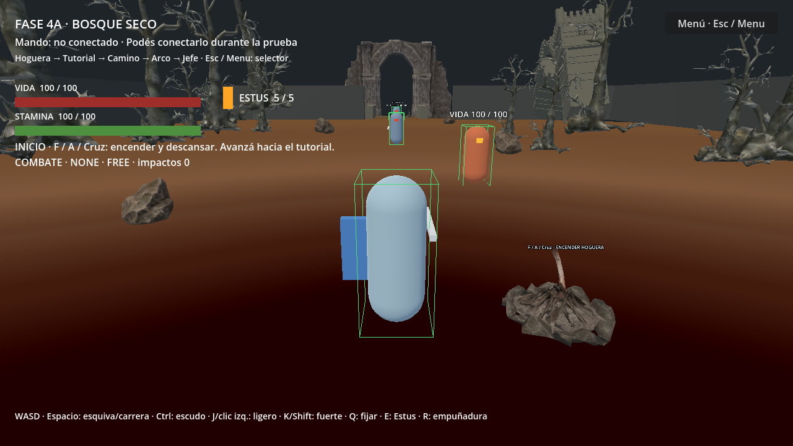
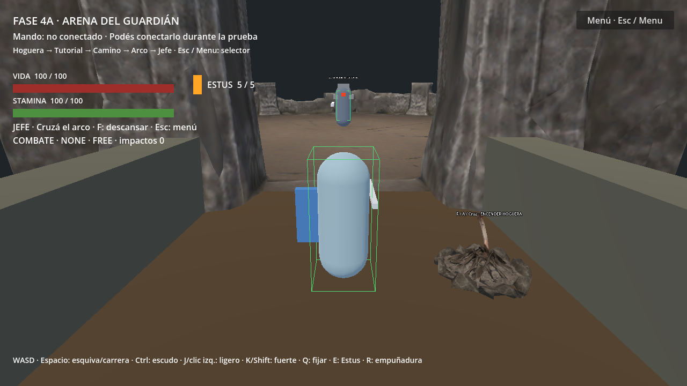
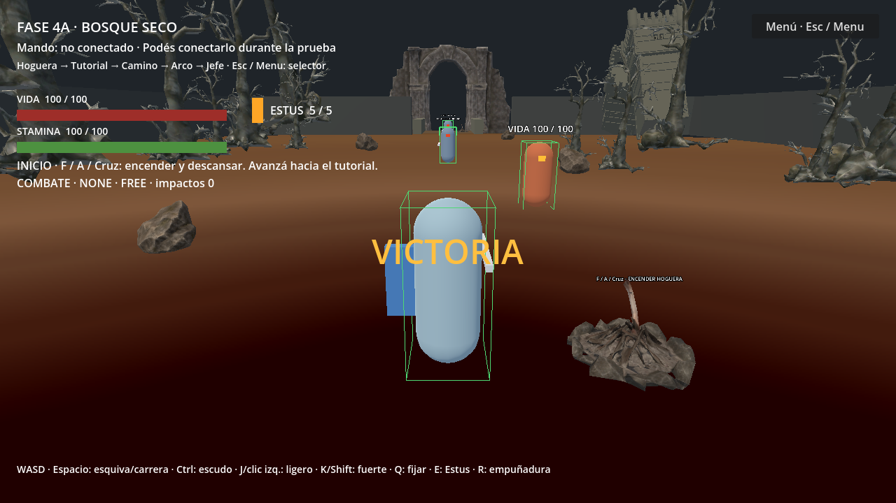

# Fase 4B — Validación integral y correcciones de integración

Fecha de ejecución: 11 de noviembre de 2026. Godot 4.6.3 oficial, Compatibility, 1280 × 720. Inspección y ejecución del motor mediante Godot AI MCP conectado al editor existente. Sin Blender ni aplicaciones de modelado.

## Alcance y decisión de arranque

Se revisaron project.godot, README, los informes/JSON/scripts de 4A y 3C, main_level, ruins_boss_arena, bosque, arena, rocas, hogueras, selector y sus materiales; además las APIs de PlayerController, cámara/SpringArm, checkpoint, soldado, jefe, atributos y ejecutor de ataques.

Problema confirmado: F5 abría el selector, mientras que esta fase pide abrir el nivel integrado. Se cambia únicamente application/run/main_scene a res://scenes/levels/main_level.tscn. El selector se conserva, accesible con Esc/Menu/Options y el botón Menú; mantiene las tres opciones y la guía de controles. F6 sigue ejecutando la escena abierta: se deja abierta ruins_boss_arena.tscn al entregar. F6 no es una tecla de viaje dentro del juego.

No se cambiaron escenas del nivel, geometría, materiales ni lógica de combate para conseguir resultados positivos. No se reincorporaron montañas, cielos duplicados ni fragmentos descartados.

## Corrección explícita de pruebas históricas

1. tests/phase_3c_checks.gd: main_scene_configuration_preserved exigía test_arena.tscn. Esa escena dejó de ser principal deliberadamente con el selector y ahora con el nivel integrado. La expectativa exige main_level.tscn y también la existencia de la arena técnica y del selector. No se elimina el check ni se acepta cualquier escena. Se mantiene la cobertura funcional del jefe en la arena técnica.
2. tests/phase_4a_checks.gd: f5_selector_preserved se reemplaza por f5_integrated_level_and_selector_preserved, que exige el nuevo arranque y conserva la disponibilidad del selector. La nueva suite comprueba además las tres PackedScene concretas y ejecuta el botón del nivel al probar victoria entre escenas.

Los informes y JSON históricos no se sobrescriben. El wrapper 4B llama run() en lugar de los start() que escriben resultados antiguos. Los resultados actuales se guardan con prefijo phase_4b. La modificación corresponde a un contrato de arranque deliberadamente actualizado, no a una corrección de patrones de combate.

## Recorrido y combate integrados

La suite nueva recorre por física e inputs simulados: hoguera inicial → tutorial → primer soldado → rodeo del cadáver → segundo soldado → hoguera del acceso → arco → combate contra jefe → victoria. No hay traslados técnicos durante este recorrido. El agente de prueba dirige la locomoción mediante acciones simuladas y orienta técnicamente el nodo visual hacia el actor antes de solicitar ataques fuertes por la API existente; no simula la destreza humana ni un mando físico. El jefe y ambos cerebros de soldados permanecen activos, con las hitboxes/hurtboxes y la stamina reales. Se comprueba un protagonista único y continuidad del checkpoint en el arco.

Cada soldado recibió cuatro ataques fuertes aceptados y pasó de 180 a cero de vida; ambos infligieron 40 puntos durante el tramo de combate. El jefe pasó de 600 a cero mediante 14 solicitudes de ataque aceptadas; activó fase 2 e infligió 416 puntos. No se fuerza la muerte de estos actores por una API directa de daño en esta prueba de recorrido.

**Aislamiento declarado:** se amplía temporalmente la vida máxima del protagonista a 1000 durante la ruta de combate para permitir una ejecución automática sin estrategia humana de defensa. No se modifica stamina, tiempos, daño ni IA. Esto valida integración/contactos, no demuestra que esa estrategia sea viable con 100 de vida ni valida balance. Las pruebas separadas de daño de soldados utilizan vida normal. La suite 4A reejecutada verifica muerte/reaparición y evasión con los componentes reales y sus aislamientos históricos documentados.

La victoria desactiva ataque/lock-on del jefe y se conserva al descargar el nivel, entrar al selector y volver a cargarlo en la misma sesión. No hay persistencia en disco. Los cadáveres conservan sus colisiones; el recorrido los rodea sin eliminarlos.

## Colisiones y cámara

- Bosque: 625 rayos verticales en rejilla de 2 m, sin muestras de suelo ausente. Las consultas detectan cualquier superficie World; no describen toda la forma visual ni garantizan cobertura continua entre muestras.
- Conexión: 85 muestras verticales, comprobaciones de ambas barandas y recorrido físico por el arco.
- Arena: 81 muestras verticales centrales, más cuatro aterrizajes físicos cardinales; conservan apoyo.
- Proxies: 12 troncos, cuatro rocas y 25 piezas de ruina con formas válidas y capa World. No se añaden colisiones detalladas a ramas u ornamentos.
- Rocas: acercamiento físico y retirada en las cuatro instancias, sin quedar atrapado en esas pruebas.
- Bordes: empuje durante 75 ticks y retirada en límites oeste, este, sur y ambos laterales del acceso; mínimo Y por encima de -0,2 y apoyo conservado en todos.
- Cámara: contracción ante el muro y recuperación en espacio libre; doce comprobaciones de contracción frente a los troncos; máscara física conservada.

No se encontró un defecto de colisión reproducible que justificara editar el escenario en las muestras realizadas. **No se afirma que sea imposible quedar atrapado en cualquier punto continuo del mapa.** Faltan recorridas manuales de esquinas, encuentros de proxies y ruinas completas, especialmente con distintas inclinaciones de cámara. La persecución sigue siendo directa, sin navegación alrededor de edificios complejos.

## Materiales y evidencia visual

Auditoría actual: 151 MeshInstance3D de bosque/arena/rocas, cero slots de material nulos y cero materiales uniformemente blancos sin textura según el detector. Un material uniforme oscuro no se considera textura recuperada ni defecto automáticamente. Se conservan los materiales de color provisional, UV/texturas válidas y recursos derivados de 4A.

Se inspeccionó una captura real del punto inicial: roca, hoguera, suelo, ruinas y árboles renderizan con sus materiales. El suelo mantiene el aspecto marrón de la entrega y las ruinas usan soluciones provisionales. No se atribuye calidad artística definitiva a esta verificación. La evidencia de victoria tras recarga se conserva en phase_4b_evidence; la imagen corresponde al estado real posterior al recorrido, no a una ilustración. La revisión visual fue estática, no una evaluación jugable continua.

## Resultados

La suite de recorrido/materiales/IA aprobó 47/47 checks y la suite espacial 26/26 (73 comprobaciones nuevas en conjunto, antes de la prueba adicional de reintento). La repetición integrada de 4A aprobó 64/64. La comparación de integridad contra 4A verificó 111 archivos sin cambios; la resolución actual de 268 dependencias no encontró referencias rotas ni GLB originales como dependencias cargables. Consultar los JSON actuales junto con este informe. No sumar las regresiones entre fases como funcionalidades independientes: contienen checks repetidos. Las ejecuciones automáticas usan el reloj de física y entradas simuladas; no hubo mando físico.

## Rendimiento observado

Doce muestras estacionarias posteriores al combate en la arena, con editor activo, 1280 × 720: FPS 60–61; física 3,136–4,974 ms (media 3,922 ms); TIME_PROCESS 16,537–17,660 ms (media 17,061 ms). Estos monitores no son percentiles ni un perfil completo de CPU/GPU.

Objetos Godot: 2464; nodos: 446; draw calls 30–32; primitivas 12.268–12.276. Memoria estática del monitor ≈93,8 MiB; texturas ≈53,1 MiB; memoria de vídeo monitorizada ≈65,9 MiB. La memoria estática de Godot NO equivale al total de RAM del proceso ni al consumo del sistema.

Equipo informado: Ryzen 5 3450U, AMD Radeon(TM) Graphics, RAM física informada ≈6,32 GB. No es la PC objetivo Ryzen 7/4 GB. No se garantiza rendimiento en 4 GB ni 60 FPS sostenidos durante todo el recorrido. La muestra después de victoria tiene menos actividad que un combate; hace falta medir la exportación, carga fría, combate prolongado y ángulos adversos en el hardware escolar.

## Archivos

Modificados en esta fase: project.godot (solo escena principal), tests/phase_3c_checks.gd y tests/phase_4a_checks.gd (expectativas justificadas), README.md (acceso actual y enlace al informe).

Nuevos: phase_4b_retry.gd (muerte y segunda entrada con atributos normales), phase_4b_checks.gd (recorrido/materiales/IA/rendimiento), phase_4b_spatial.gd (bordes/cámara), phase_4b_regressions.gd (wrapper de regresiones), JSON de resultados/auditoría/integridad, evidencia real, este informe y cliente auxiliar phase_4b_mcp.py. Los archivos phase_4b_*poll/eval*.gd.txt son solicitudes técnicas temporales del cliente, no scripts de juego. El cliente usa el servidor local Godot AI MCP y no requiere instalar complementos.

## Incidencias de las fixtures

La preparación inicial llamó restore_at_checkpoint con relocate=false, por lo que los probes no trasladaban al jugador. Se corrigió solo la fixture y se reinició el proceso antes de aceptar resultados. El caminante técnico además frenaba con entradas cada vez menores hasta la deadzone; se ajustó la tolerancia de llegada de la fixture a 0,3 m, manteniendo la comprobación física final menor a 0,4 m. No se cambió la deadzone del juego. Una consulta MCP temporal con indentación incompatible falló al compilar; se descartó y reinició la ejecución. Estos incidentes no son correcciones ocultas del controlador.

## Pendientes y recomendaciones

Evaluación manual de esquinas y cámara, ajuste artístico de materiales provisionales, prueba USB/Bluetooth real, balance con atributos normales, medición en 4 GB y revisión del empaquetado antes de distribuir. No se acredita duración de 15–25 minutos. No se añadieron mecánicas, actores finales, animaciones, optimizaciones destructivas o modelos descartados. No se avanzó a otra fase.

## Regresiones históricas ejecutadas

| Fase | Aprobadas / ejecutadas |
|---|---:|
| 1A | 16/16 |
| 1B | 44/44 |
| 1C | 38/38 |
| 1D | 47/47 |
| 2A | 59/59 |
| 2B | 63/63 |
| 2C | 60/60 |
| 2D | 63/63 |
| 2E | 77/77 |
| 3A | 61/61 |
| 3B | 62/62 |
| 3C (expectativa actualizada) | 73/73 |
| 4A integrada (expectativa actualizada) | 64/64 |

1A–3B suma 590 comprobaciones en esta ejecución, sin fallos. Los aislamientos del runner histórico se conservan: toque corto en 1B/1D/2A, backstab en 2C, soldado autónomo fuera de 3A/3B y ciclo automático de checkpoint fuera de 3B. No se presentan como integración simultánea de todos los sistemas. Las nuevas pruebas de recorrido y reintento complementan esas fixtures con actores reales activos.

## Reintento con atributos normales

phase_4b_retry.json: **8/8**. Desde una colocación técnica inicial junto a la hoguera del acceso, el jugador descansa, camina al encuentro, muere por ataques autónomos del jefe, observa el ciclo de reaparición, conserva forest_gate, recupera 100 de vida/5 Estus/FREE y vuelve caminando a iniciar el encuentro. Jefe a 600 de vida/fase 1, sin hitboxes residuales; mismas instancias. Ninguna IA desactivada ni vida ampliada en esta prueba. Total nuevo 4B: **81/81** (47 recorrido/auditoría + 26 espaciales + 8 reintento).

## Cierre y estado de entrega

Se ejecutó la escena abierta mediante project_run(mode=current), equivalente a F6: ruins_boss_arena.tscn, jugador apoyado en suelo con vida/stamina 100 y 5 Estus; jefe IDLE, 600 HP, fase 1 y hitbox ofensiva apagada. También se ejecutó nuevamente project_run(mode=main), equivalente a F5: main_level.tscn con un único jugador, 100 HP y 5 Estus. Datos en phase_4b_final_startup.json y phase_4b_f5_startup.json.

Los logs finales no registran errores de parser/runtime. El panel del editor conserva seis advertencias estáticas preexistentes: sombreado de owner en action_state, sombreado de name en attack_controller y uso potencial de best sin asignación explícita en lock_on_controller. Se documentan sin silenciarlas ni modificar combate. Los logs se adjuntan como phase_4b_final_*_log.json y phase_4b_f5_game_log.json.

El servidor local Godot AI MCP se interrumpió después de guardar el resultado de reintento. Se restableció su proceso y la conexión con el mismo editor; luego se completaron ambos arranques y la lectura de logs. No se atribuye una causa no comprobada ni se modifican configuraciones globales.

Se deja la ejecución detenida y ruins_boss_arena.tscn abierta para F6; F5 abre directamente main_level.tscn. Esc mantiene el selector con controles. No hay mando físico conectado ni ensayo manual prolongado. Las validaciones físicas son simulaciones ejecutadas dentro de Godot, no entradas de hardware reales.

### Capturas reales

Figura 1. Arranque F5 del nivel integrado; modelos de actores provisionales y materiales actuales. Captura estática sin modificaciones gráficas.

Figura 2. Arranque F6 de la arena artística; hoguera, acceso, suelo y límites visibles. No acredita por sí sola colisiones o calidad jugable.

Figura 3. Estado real de victoria después de volver del recorrido al menú y recargar el nivel. La imagen muestra el inicio con victoria persistente, no un instante del golpe final.

Los resultados, scripts de prueba y este informe quedan dentro de tests/. No se modificaron los informes históricos ni recursos artísticos originales. No se avanzó a otra fase.
