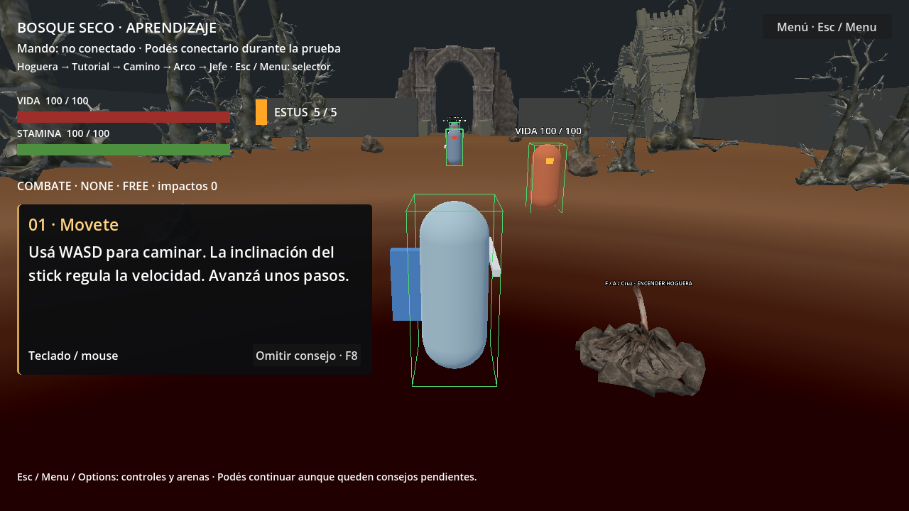

# Fase 5A — Tutorial interactivo y orientación

Godot 4.6.3 oficial, GDScript, Compatibility, 1280 × 720. Fecha: 11 de noviembre de 2026. Motor inspeccionado y ejecutado mediante Godot AI MCP conectado al editor existente. No se utilizó Blender ni se instalaron complementos.

## Alcance y auditoría

Se inspeccionaron main_level.tscn, HUD y rutas, el selector y la arena artística, integrated_level.gd y test_arena.gd, InputMap, ControllerRegistry, APIs de locomoción/cámara/lock-on, atributos, AttackController, DefenseController, DodgeController, EstusController, CheckpointManager, Bonfire y EncounterEntry/GuardianBrain; además las suites de 4A/4B y su runner histórico. Existían consejos estáticos por zona, pero no un registro interactivo de lecciones.

La escena principal sigue siendo main_level.tscn. No se crea otro nivel ni se cambia el recorrido, IA, hitboxes, costes o tiempos. La arena artística independiente se conserva para F6, sin imponerle el tutorial inicial. Los viejos textos por sector se ocultan únicamente en el nivel que contiene TutorialController; el modo directo de jefe conserva su orientación anterior.

## Arquitectura y archivos

Nuevos componentes:
- scripts/systems/tutorial_lesson.gd: Resource editable con id, título, texto, contexto, evento de finalización y permiso para omitir.
- scripts/systems/tutorial_catalog.gd: lista ordenada de lecciones.
- resources/tutorial/intro_lessons.tres: diez lecciones configurables, sin dependencias artísticas.
- scripts/systems/tutorial_controller.gd: observador pasivo con referencias explícitas al jugador, cámara, lock-on, checkpoint, jefe y hoguera de acceso. No reclama estados ni escribe atributos del jugador.
- scripts/systems/tutorial_input_hints.gd: nombres de controles según la distribución anunciada por Godot; no interpreta índices físicos en el combate.
- scripts/systems/tutorial_panel.gd y scenes/ui/tutorial_panel.tscn: interfaz separada con transición por Tween e indicación de dispositivo.

Modificados: scenes/levels/main_level.tscn para inyectar controlador/panel y ajustar textos de presentación; scripts/systems/integrated_level.gd para ocultar el consejo estático duplicado; README.md para acceso/documentación. Ningún controlador de combate, IA, InputMap, perfil de ataques/rodadas/parry, modelo ni animación fue modificado.

Nuevos archivos de validación: phase_5a_checks.gd, phase_5a_context_checks.gd, phase_5a_regressions.gd, cliente MCP auxiliar, JSON de resultados, integridad y diagnóstico, capturas reales y este informe dentro de tests/.

## Secuencia y condiciones

La prioridad es el orden del catálogo entre instrucciones pendientes cuyo contexto sea válido. No se obliga a terminar una lección irrelevante para poder ver otra ni se limita el movimiento del protagonista.

| ID / prioridad | Cuándo aparece | Qué la completa |
|---|---|---|
| move / 1 | Jugador vivo fuera del encuentro | Desplazamiento horizontal real acumulado de 2 m con entrada de locomoción, sin contar snaps o rodadas |
| camera / 2 | Igual, tras las prioridades pendientes aplicables | Giro libre acumulado de 15° entre yaw/pitch reales; no cuenta el seguimiento externo del lock-on |
| bonfire / 3 | Dentro del área real de una hoguera del gestor | checkpoint_activated después de una activación válida |
| lock / 4 | Objetivo disponible a ≤8 m y adquirible por el lock-on existente (cámara, alcance y línea de visión) | target_changed con referencia válida |
| light / 5 | Objetivo cercano y visible | attack_started de un perfil LIGHT; se acredita ejecución aceptada, no necesariamente daño |
| heavy / 6 | Igual | attack_started de un perfil HEAVY |
| block / 7 | Igual | defense_event shield_raised; acredita levantar el escudo, no un impacto bloqueado |
| dodge / 8 | Igual | dodge_started direccional; backstep no satisface esta lección |
| estus / 9 | Herido y con alguna carga | EstusController.used con curación positiva en el instante real de uso |
| entry / 10 | A <12 m de la hoguera de acceso y jefe vivo | encounter_started del cerebro existente al cruzar la entrada |

El observador registra las acciones aunque su texto todavía no haya aparecido. Una entrada rechazada por falta de stamina/estado no genera la señal de ataque y no se acredita. Preparar Estus sin llegar a la curación tampoco completa la lección. No se induce daño ni se regalan cargas para enseñar a beber: si la vida está completa, el consejo espera o se puede seguir avanzando. En dos manos, el consejo de escudo explica volver primero a una mano con el control correspondiente.

Los únicos umbrales de aprendizaje son distancia recorrida y giro observado. Las finalizaciones no dependen de esperar un temporizador. Los Tween solo presentan/retiran el panel.

## Omisión, muerte y sesión

Cada lección permite omisión explícita mediante el botón Omitir consejo (mouse/interfaz) o F8 técnico, sin nuevas acciones en InputMap. Las omisiones quedan separadas de las acciones completadas. Si después se realiza una acción omitida también puede acreditarse como completada. Se puede continuar caminando y llegar al jefe sin terminar u omitir manualmente todos los consejos; no hay puertas ni permisos ligados al tutorial.

El progreso se conserva en metadatos del nodo raíz SceneTree, identificado por session_id=forest_intro_v1. Sobrevive a muerte, reaparición y recarga desde el selector durante la misma ejecución. No se escribe en disco ni se crea otro autoload. Cerrar el juego comienza una sesión vacía. Una futura revisión incompatible del catálogo puede usar otro session_id.

Durante DEAD y la secuencia de reaparición el panel se retira; durante el encuentro con el jefe se oculta para despejar el HUD y no registra lecciones como completadas por ese ocultamiento. La entrada sí se completa mediante el evento real del encuentro. Al reaparecer se vuelven a evaluar solo pendientes relevantes.

## Controles y detección

Inicio: teclado si no hay mando, o primer dispositivo disponible como hipótesis inicial. Luego se usa la última entrada efectiva: tecla/botón del mouse o arrastre de cámara, botón de mando o eje con magnitud superior a 0,3. Movimientos pequeños del stick no cambian el perfil. La desconexión del dispositivo activo devuelve los consejos al teclado.

- Xbox: stick izquierdo/derecho, A, R3, RB, RT, LB, B, X, Y.
- PlayStation: equivalentes físicos Cruz, R3, R1, R2, L1, Círculo, Cuadrado, Triángulo.
- Teclado/mouse: WASD, flechas/arrastre derecho, F, Q/rueda, clic izquierdo/J, Shift/K, Ctrl, Espacio, E y R.
- Genérico desconocido: nombres de acciones legibles (movimiento, cámara, interacción, fijación, ataques, bloqueo, esquiva y objeto), sin inventar índices ni afirmar una marca.

Xbox/PlayStation se eligen conservadoramente a partir de mapeo reconocido y nombre/vendor anunciado. El texto dice distribución, no modelo físico verificado. Un nombre Xbox sin mapeo reconocido sigue siendo genérico. No hay remapeo nuevo; un cambio futuro de InputMap necesitará actualizar el recurso de etiquetas. No se realizaron pruebas físicas con joystick; metadatos y eventos de mando se simularon.

## Interfaz y revisión visual

Panel en el lateral izquierdo: x=24..524, y≈288..528 en la base 1280 × 720. Título 23 px, texto 21 px, fondo oscuro opaco/translúcido, texto contrastado. Se excluyen el espacio de barras de vida/stamina y el del HUD del jefe. El resto del panel ignora el mouse; solo Omitir es interactivo. No se captura el mouse ni se pausa la física.

Aparición/retirada de 0,18 s por Tween; las señales actualizan contenido únicamente cuando cambia la instrucción o el perfil. La primera revisión estática detectó que una disposición más ancha a la derecha tapaba al personaje; se reubicó a la izquierda y se repitieron los 40 layouts (diez lecciones × cuatro perfiles). El centro del combate queda visible. Las capturas son imágenes reales del juego, no ilustraciones. No sustituyen la evaluación jugable con personas nuevas.

## Pruebas y regresiones

Los resultados detallados están en los JSON con prefijo phase_5a. Se conservaron los archivos y resultados históricos. Los wrappers cargan el código histórico y redirigen únicamente las rutas de salida en memoria, salvo la preparación de suelo explícita que se detalla abajo. No se retiraron aserciones ni se alteraron expectativas de arranque en esta fase.

La suite nueva incluye acciones reales aceptadas por los componentes, física y giros de cámara, repetición y omisión, daño/curación diferida, muerte/respawn, entrada caminando con lecciones pendientes, recarga por selector, metadatos de mando simulados y comprobación de 40 layouts. Los tests de layout invocan la presentación directamente; esos casos no se atribuyen a interacción humana ni a un dispositivo conectado.

Los recorridos de 4B conservan sus aislamientos declarados: vida ampliada durante el agente que derrota a soldados y jefe, stamina/IA/colisiones activas; prueba de reintento separada con atributos normales. 4A conserva sus fixtures de patrones con decisiones suspendidas y actores/hitboxes activos. El runner de 1A–3B mantiene los aislamientos históricos de toque corto, backstab, soldado y checkpoint documentados en 4B. Se ejecutan también integraciones reales con tutorial y actores activos, no solo fixtures aisladas.

### Incidencia de preparación del reintento

La primera ejecución encadenada de phase_4b_retry.gd aprobó 5/8: no pudo descansar en la hoguera del acceso y, por ello, reapareció en el inicio y no alcanzó el segundo encuentro dentro del tramo esperado. Se conserva phase_5a_regression_4b_retry.json con esos fallos y retry_initial en el resumen.

El diagnóstico guardado en phase_5a_retry_ground_diagnostic.json muestra que, tras colocar la cápsula a y=0,1 con velocidad cero, en el tick 8 sigue en el aire (y≈0,002), y en el 9 is_on_floor pasa a verdadero y can_interact se habilita. El archivo histórico no fue modificado. El wrapper nuevo retry_grounded sustituye solo esa espera inicial por un bucle acotado de hasta 30 ticks que espera suelo real y pertenencia al área. Mantiene todos los checks, atributos normales y componentes activos. Su resultado queda separado en phase_5a_retry_grounded.json.

Al añadir un método al runner ya cargado, una consulta técnica encontró la versión anterior en caché. Se reinició el proceso y se cargó el script actualizado; ese error de herramienta no se presenta como error de gameplay corregido.

## Limitaciones y preparación posterior

La experiencia con personas sin práctica, legibilidad en otras escalas de pantalla y dispositivos físicos requieren pruebas manuales. El tutorial acredita intentar ataques válidos y levantar escudo; no certifica dominio del timing, daño efectivo, bloqueo exitoso o estrategia. No enseña todavía parry, riposte, backstab ni dos manos como lecciones separadas: esta fase mantiene la secuencia solicitada de diez controles esenciales.

Los nombres de controles de teclado corresponden a los bindings actuales y no a un remapeo dinámico. El perfil genérico permite neutralidad, pero necesita comprobar su mapeo en hardware. No hay persistencia, analítica externa, audio, modelos ni animaciones nuevos. Tampoco se atribuye rendimiento en 4 GB a estas pruebas.

El catálogo Resource, señales instruction_changed/lesson_completed/lesson_skipped, session_id y panel independiente permiten modificar textos, prioridades y presentación en otra fase sin cambiar el combate. No se avanzó automáticamente.

## Resultados actuales de tutorial e integración

| Suite | Resultado final |
|---|---:|
| Tutorial: acciones, orden, muerte, sesión, controles y 40 layouts | 53/53 |
| Contextos adicionales: pared/visibilidad, dos manos, botón de omisión y jefe derrotado | 10/10 |
| Regresión 4B: recorrido completo, combate y victoria | 47/47 |
| Regresión 4B: bordes, retirada y cámara | 26/26 |
| Regresión 4B: reintento, preparación de suelo explícita | 8/8 |
| Regresión 4A integrada | 64/64 |

Son 63 checks nuevos de 5A. Los 40 layouts están comprendidos en un check agregado, no se suman otra vez como 40 pruebas independientes. La primera variante histórica del reintento dio 5/8 y sigue guardada; el 8/8 corresponde a la preparación con suelo real descrita, con idénticas expectativas y componentes activos.

La integridad compara 84 archivos de scripts/perfiles de combate, IA y sus UID contra el inicio de 5A: cero cambios. Ver phase_5a_integrity.json. No se editaron las suites históricas para conseguir resultados positivos; las salidas actuales están separadas.

Figura 1. Captura real a 1280 × 720 del panel lateral de movimiento, sin tapar al protagonista ni las barras. Revisión estática; no se atribuye a una evaluación manual de aprendizaje.

## Regresiones históricas y cierre

| Fase | Aprobadas / ejecutadas |
|---|---:|
| 1A | 16/16 |
| 1B | 44/44 |
| 1C | 38/38 |
| 1D | 47/47 |
| 2A | 59/59 |
| 2B | 63/63 |
| 2C | 60/60 |
| 2D | 63/63 |
| 2E | 77/77 |
| 3A | 61/61 |
| 3B | 62/62 |
| 3C | 73/73 |

Las suites 1A–3B completaron 590/590 comprobaciones, y 3C 73/73. No se suman esas regresiones repetidas como funcionalidades nuevas. La suite de 4B usa el ajuste de preparación documentado; el fallo inicial se conserva.

F5 se verificó mediante project_run(mode=main): main_level.tscn, instrucción move, progreso completado/omitido vacío en proceso nuevo, perfil teclado, panel (24,288) de 500 × 240, jugador en suelo con vida/stamina 100 y 5 Estus. F6 se verificó mediante mode=current con ruins_boss_arena.tscn abierta: tutorial inicial ausente, jugador apoyado y jefe con 600 HP/fase 1. Ver phase_5a_f5_startup.json y phase_5a_f6_startup.json.

Los logs finales de ambos arranques no registran errores de parser/runtime. El editor conserva seis advertencias estáticas preexistentes (owner/name sombrean propiedades y best podría usarse sin asignación explícita). No se silenciaron ni se alteró el combate para quitarlas. Los JSON de logs se adjuntan.

Se deja el juego detenido, la arena artística abierta para F6 y el nivel integrado configurado para F5. No se avanzó a otra fase. Faltan evaluación de aprendizaje con personas nuevas, joystick físico y mediciones en el hardware objetivo; la revisión visual fue estática.
