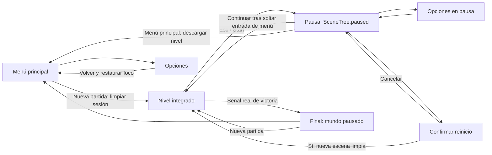
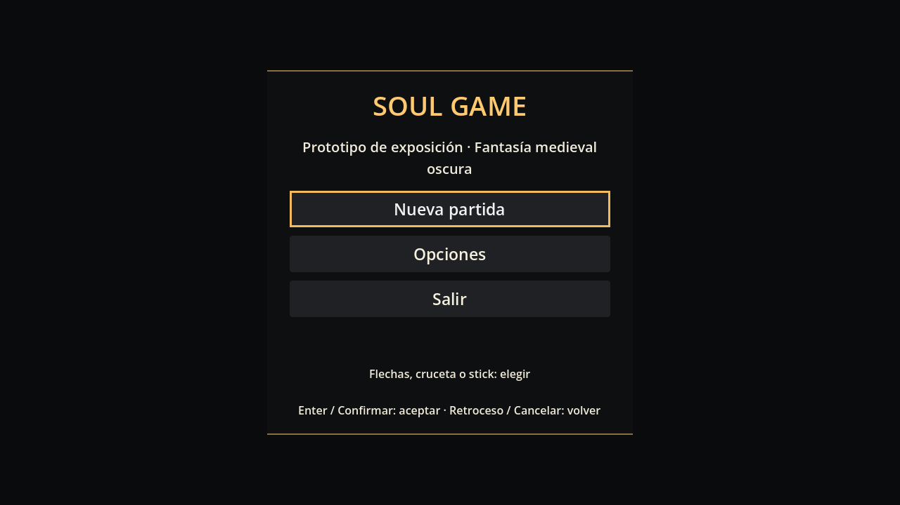
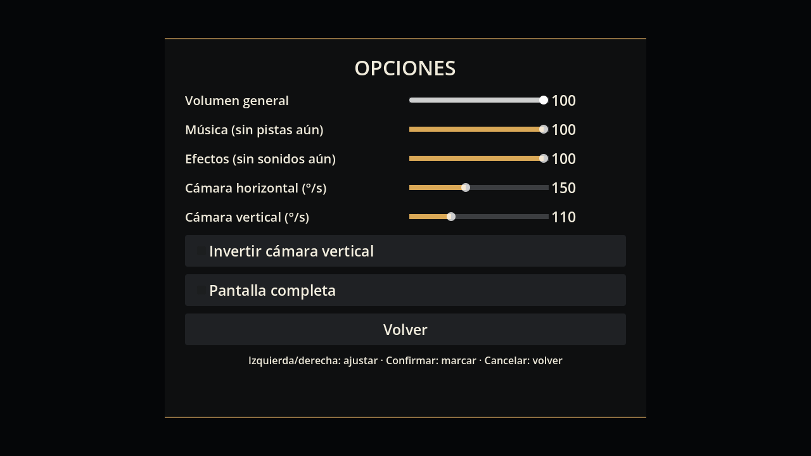
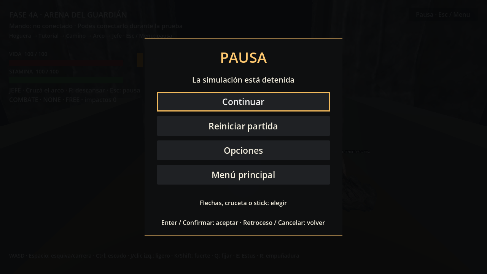
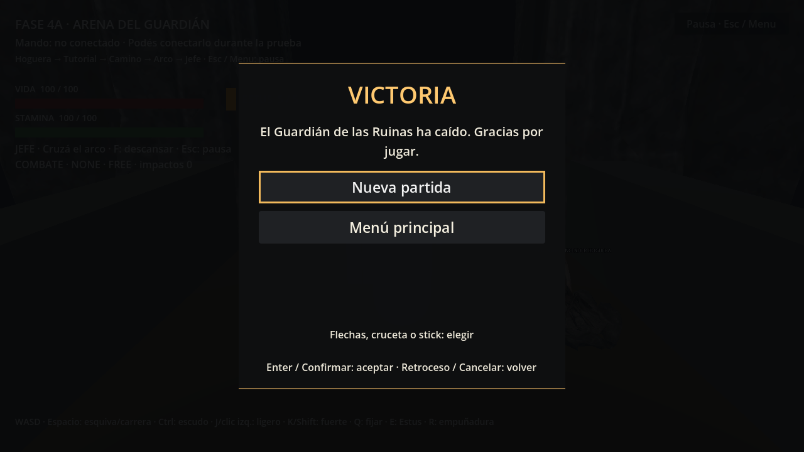

# Fase 5B — Menú principal, pausa, opciones y finalización

Godot 4.6.3 oficial / GDScript / Compatibility / base 1280 × 720. Fecha: 11 de noviembre de 2026. Inspección y ejecución mediante Godot AI MCP. Sin Blender, modelos, animaciones, sonidos ni complementos nuevos.

## Auditoría y arquitectura

Se inspeccionaron project.godot, InputMap, main_level y la arena artística, ControllerRegistry, SessionProgress, CheckpointManager, señales de victoria de GuardianBrain/BossHUD, tutorial, cámara y los adaptadores de menú previos. Los únicos datos de progreso global existentes eran defeated_bosses y tutorial_progress, almacenados en el nodo raíz durante la ejecución. No se encontró un gestor global de menús/pausa ni preferencias de audio.

Se agregó una única capa persistente de presentación: GameMenus (CanvasLayer autoload, ALWAYS, layer 200). No sustituye los gestores de atributos, muerte, enemigos o checkpoints. Reutiliza SessionProgress para limpiar la sesión y CheckpointManager para el punto inicial. Se enlaza a las escenas mediante su contrato existente Player / Boss / CameraRig / CheckpointManager; no hay referencias absolutas a actores de una escena anterior.

### Escenas nuevas

- scenes/ui/main_menu.tscn: escena principal de F5; título provisional tomado de config/name, Nueva partida, Opciones y Salir.
- scenes/ui/menu_screen.tscn: vista reutilizada para elecciones principales, pausa, confirmación y victoria.
- scenes/ui/options_panel.tscn: preferencias de audio, cámara y ventana.
- scenes/ui/game_menus.tscn: capa persistente y sus vistas.

### Scripts y recursos nuevos

- scripts/systems/game_menus.gd: navegación, estados de interfaz, pausa y cambio de escenas.
- scripts/systems/menu_screen.gd, main_menu.gd, options_panel.gd: presentación separada del ciclo de partida.
- scripts/systems/game_options.gd: preferencias validadas, buses y adaptación de cámara/ventana.
- resources/ui/menu_theme.tres: tema compartido oscuro, acento bronce, texto legible y foco visible. Sin imágenes externas.

### Archivos modificados

project.godot: F5 pasa a main_menu.tscn y se registra GameMenus. InputMap permanece intacto.
SessionProgress recibe reset_session(), que elimina únicamente los dos metadatos de progreso; conserva preferencias y metadatos ajenos. CheckpointManager recibe establish_initial_checkpoint(), una API de arranque sin falsa interacción. ArenaMenuLink y su botón pasan a abrir pausa. Se actualizaron las indicaciones de Esc en main_level, ruins_boss_arena, integrated_level y en el selector histórico; README refleja el acceso actual.

No se modificaron PlayerController, IA de soldado/jefe, hitboxes/hurtboxes, estados ni perfiles/tiempos de ataque, parry o esquiva. Los modelos originales no se modifican. La integridad se verifica contra el inicio de esta fase.

## Estados de menú y partida

GameMenus usa estados de interfaz NONE, PAUSE, OPTIONS, CONFIRM_RESTART, VICTORY y TRANSITION. NONE significa juego activo o menú principal sin submenú; se distingue por la escena cargada. Estos estados no duplican FREE/ATTACKING/DEAD del protagonista.

No hay guardado de progreso. Volver al menú descarga el nivel; continuar se realiza desde pausa, con el nivel todavía cargado. Desde el menú principal se ofrece una partida nueva, no una carga de la anterior.

## Nueva partida y reinicio

El mismo flujo sirve para Nueva partida, reinicio confirmado y nueva partida después de victoria:

1. Bloquear solicitudes simultáneas con una transición única.
2. Limpiar defeated_bosses y tutorial_progress mediante el componente existente.
3. Descargar la escena anterior y cargar una instancia fresca de main_level.
4. Mantener el mundo pausado mientras se instala y mientras siga pulsada la confirmación del menú.
5. Establecer forest_start como checkpoint inicial. El jugador parte con vida/stamina 100, cinco Estus, ONE_HANDED y estados/buffers/reservas limpios por inicialización de sus componentes existentes.
6. Aplicar las preferencias de cámara y recuperar la simulación tras la liberación de entradas de menú.

El punto inicial se registra sin encender visualmente la hoguera ni emitir checkpoint_activated: el tutorial debe seguir enseñando una interacción real. Morir antes de encenderla igualmente utiliza ese punto de reaparición.

No se intenta devolver a la vida al viejo jefe mediante una excepción a su política de derrota. Se elimina la memoria de derrota y se crea el nivel limpio; jefe y soldados se inicializan en sus escenas reutilizables. Se comprueban instancias únicas, vida completa, jefe en fase 1 y ausencia de reservas críticas/hitboxes residuales. Las opciones no se reinician.

Reiniciar desde pausa abre confirmación con Cancelar como foco predeterminado. Cancelar conserva el mundo y devuelve el foco a Reiniciar partida; confirmar utiliza el mismo arranque limpio.

## Pausa y navegación

Se usa SceneTree.paused. Actores, IA, cámara, atributos, tutorial y relojes lógicos existentes heredan PAUSABLE; la capa de interfaz usa ALWAYS y continúa atendiendo entradas. No se suspenden componentes uno por uno ni se fuerza un estado FREE para pausar. Los timers de prueba/UI que deben funcionar durante pausa son explícitamente independientes; los relojes del juego auditados avanzan en física.

Continuar conserva posiciones, fases, elapsed de ataques/curación, stamina, tutorial y memoria de sesión. Si confirmar/cancelar/pausa sigue pulsado, el mundo continúa congelado hasta su liberación. Esto impide que A/B/Enter/Espacio usados en la interfaz se conviertan en una acción de juego al continuar o al comenzar. Espacio también es ui_accept de Godot y se gestiona junto con menu_confirm, evitando una activación nativa duplicada.

Entradas: ui_up/down para flechas y cruceta; move_* para stick izquierdo/WASD; menu_confirm/ui_accept, menu_cancel y pause_game para aceptar, cancelar y pausar. No se codifican índices físicos de mandos genéricos. El stick requiere volver a neutral (0,25) antes de otra navegación y dispara a partir de 0,6. No se repite una selección mientras se sostiene inclinado. Izquierda/derecha ajustan sliders y checkboxes en Opciones.

Confirmaciones duplicadas se filtran por pulsación y por frame; las transiciones también tienen exclusión mutua. Cada pantalla tiene foco inicial, borde de foco visible y recorrido cíclico; Opciones devuelve el foco al control que la abrió. Teclado y mouse siguen disponibles. El genérico desconocido depende del mapeo reconocido/configurado por Godot, no se afirma compatibilidad con índices arbitrarios de hardware sin mapear.

## Opciones y persistencia

Opciones: volumen Master, Music y SFX (0–100); sensibilidad horizontal/vertical (10–360 grados/s); inversión vertical; pantalla completa/ventana. Valores iniciales de cámara 150/110, conforme a la configuración previa, sin alterar archivos de cámara.

Los buses Music y SFX se crean si faltan y se envían a Master. Se aplica volumen con conversión lineal a dB; cero silencia el bus sin producir un infinito. No hay pistas ni sonidos: se verifican valores de buses, no calidad ni mezcla audible.

Las opciones modifican inmediatamente el backend y la instancia actual de CameraRig. La nueva escena recibe las mismas preferencias. Se conserva un ConfigFile en user://preferences.cfg con solo siete claves de la sección options, sin vida, checkpoints, tutorial ni victoria. Se validan tipos, valores finitos y rangos. La escritura usa un archivo temporal y renombrado. Se guarda al volver de Opciones y al cambiar F11.

Los tests usan una ruta de preferencias independiente y restauran el contenido anterior si existía; no alteran permanentemente las preferencias reales del usuario. Se prueba lectura con una instancia nueva, sustitución del archivo existente y separación de opciones/progreso. No se implementa guardado de partida.

## Victoria y finalización

La capa observa la señal victory real del jefe. Sus componentes existentes ya cancelan ataques, invalidan lock-on y detienen la IA. Después de esa resolución se abre VICTORIA y se pausa el mundo. La interfaz ofrece Nueva partida y Menú principal con foco navegable. No ofrece continuar un combate terminado ni añade cinemáticas.

Nueva partida después de ganar elimina la derrota previa, restaura jefe/fase 1 y tutorial vacío, conservando preferencias. Salir cierra el proceso del juego, no el editor. Se conserva F6 para ejecutar la arena artística abierta; también allí están disponibles pausa, opciones y pantalla final.

## Validación nueva y pantalla completa

Primera ejecución incrustada: 70/71 checks. La única no aprobada fue fullscreen_applied; Godot respondió literalmente que una ventana incrustada solo admite modo ventana. Ese JSON se conserva como phase_5b_results.json, sin convertir el fallo en una aprobación falsa.

Se ejecutó después la misma suite en una ventana nativa de Godot, lanzada **mediante Godot AI MCP test_run**. El launcher es una suite de prueba del proyecto que usa OS.create_process con el ejecutable actual de Godot y este mismo proyecto; no usa otra aplicación, no cambia opciones globales del editor ni instala un plugin. El script SceneTree nativo redirige únicamente la salida JSON, realiza los mismos checks y cierra su proceso al finalizar. Se añadieron además dos checks para la confirmación con Espacio y su barrera de liberación.

Resultado final nativo: **73/73**, incluido cambio real de DisplayServer a FULLSCREEN y vuelta a WINDOWED. Datos: phase_5b_native_results.json y phase_5b_native.log. La ventana incrustada sigue teniendo la limitación del editor; para verla cambiar de modo se necesita ejecución nativa. Las dos pasadas repiten casos y no se suman como 144 pruebas diferentes.

Las pruebas verifican menú/foco, teclado, cruceta obtenida del InputMap y navegación analógica simulada, doble confirmación, nueva sesión, pausa de movimiento/ataques/IA/atributos/tutorial/curación, continuación, cancelación y confirmación de reinicio, regeneración de actores, limpieza crítica, opciones, buses, archivo de preferencias, victoria y nueva partida posterior. No hubo joystick físico. Las capturas son reales y su revisión es estática.

## Regresiones y expectativas históricas

Se actualizaron exclusivamente las expectativas de arranque que ya no representaban el contrato del producto:
- 3C main_scene_configuration_preserved exige main_menu.tscn y comprueba que siguen disponibles main_level, test_arena y el selector histórico.
- 4A exige menú principal y conserva referencias al nivel y selector.
- 4B exige menú principal y mantiene el check de que la fixture integrada carga main_level.

No se eliminan aserciones de combate, daño, cámara o progresión. La suite nueva prueba además que Nueva partida realmente carga el nivel. Los informes y JSON antiguos se conservan.

El wrapper phase_5b_regressions.gd desactiva **solo la apertura automática de la pantalla final** durante suites mecánicas antiguas: estas esperan seguir avanzando física después de matar al jefe y la interfaz nueva pausa deliberadamente el SceneTree. BossHUD, victoria, memoria de derrota y el resto de componentes siguen activos. Los 73 checks nuevos prueban la pantalla final real con ese comportamiento habilitado. El wrapper registra el aislamiento y restaura la opción al acabar.

Se conservan los demás aislamientos históricos ya documentados (toque corto, backstab, soldado y checkpoint según fase; decisiones suspendidas en algunas fixtures de patrones). Para el reintento de 4B se mantiene el ajuste explícito de 5A: esperar suelo real y área de hoguera con límite de 30 ticks antes del primer descanso; las expectativas históricas permanecen intactas. Los resultados actuales van a archivos nuevos con prefijo phase_5b.

## Limitaciones

Pruebas automáticas y revisión visual estática; faltan ensayo con mandos USB/Bluetooth reales y evaluación de navegación por usuarios de la exposición. No se valida mezcla audible porque todavía no hay audio. El rendimiento en 4 GB y la exportación final de Windows siguen requiriendo pruebas del paquete/hardware correspondiente; no se garantiza 60 FPS por estas verificaciones.

El selector técnico anterior permanece como escena de depuración, pero Esc ahora abre pausa y Menú principal lleva a la nueva interfaz. La persistencia de opciones requiere permisos de escritura en user://. No hay inventario, guardado de progreso, RPG nuevo, personajes ni animaciones definitivas. No se avanzó a otra fase.

## Resultado final de regresiones

| Fase | Aprobadas / ejecutadas |
|---|---:|
| 1A | 16/16 |
| 1B | 44/44 |
| 1C | 38/38 |
| 1D | 47/47 |
| 2A | 59/59 |
| 2B | 63/63 |
| 2C | 60/60 |
| 2D | 63/63 |
| 2E | 77/77 |
| 3A | 61/61 |
| 3B | 62/62 |
| 3C | 73/73 |
| 4A | 64.0/64.0 |
| 4B | 81.0/81.0 |
| 5A | 63.0/63.0 |

Las comprobaciones pueden repetir contratos entre fases; no se presentan como funcionalidades o pruebas únicas acumuladas. El aislamiento de apertura automática de victoria y la preparación de suelo están registrados arriba y en el wrapper.

## Integridad, evidencia y entrega

Se compararon 142 archivos de combate, IA, perfiles y modelos originales contra el inicio de 5B: 0 cambios. Los dos cambios de APIs de ciclo de sesión (SessionProgress y CheckpointManager) son los descritos y no modifican resoluciones ni tiempos de combate.

F5 se ejecutó con main_menu.tscn, foco Nueva partida, ningún protagonista en el menú, mundo no pausado y victoria automática habilitada. F6 se ejecutó desde ruins_boss_arena.tscn: jugador apoyado con 100 HP y cinco Estus; jefe con 600 HP/fase 1 y menús disponibles. Las muestras están en phase_5b_f5_startup.json y phase_5b_f6_startup.json.

El botón Salir se activó mediante su señal de UI y cerró el proceso real del juego. editor_state confirmó is_playing=false, estado stopped y editor ready; se conserva phase_5b_exit_result.json. No se cerró el editor.

Los logs de ambos arranques finales y el log nativo no muestran errores de parser/runtime. Se adjuntan phase_5b_f5_game_log.json, phase_5b_f6_game_log.json, phase_5b_final_editor_log.json y phase_5b_native.log. Los resultados del primer ensayo incrustado conservan el fallo ambiental de pantalla completa.

Se deja el juego detenido y la arena artística abierta para F6. F5 está configurado al menú principal. No se avanzó automáticamente.

### Capturas reales

Figura 1. Menú principal real a 1280 × 720, con foco inicial visible. No se usan imágenes externas.

Figura 2. Preferencias de buses, cámara y ventana. Sin audio reproducido; revisión visual estática.

Figura 3. Pausa real de la arena artística con los cuatro botones navegables; el mundo queda congelado.

Figura 4. Pantalla final disparada por la resolución real de un golpe técnico de 10.000 puntos mediante Hurtbox. No se presenta como una partida manual completa. La señal de victoria, muerte, hitboxes y pausa son los componentes reales.
