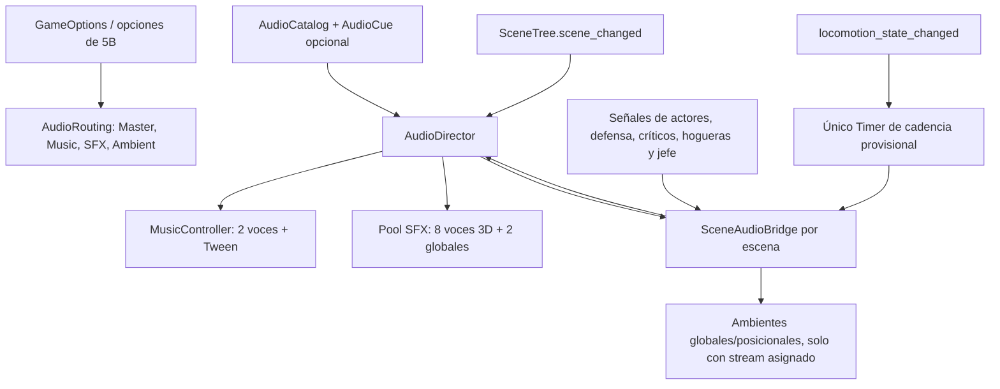

# Fase 5C — Infraestructura de audio y ambientación

Godot 4.6.3 oficial, GDScript, Compatibility, base 1280 × 720. Fecha: 11 de noviembre de 2026. Inspección, ejecución y pruebas del motor mediante Godot AI MCP. Sin Blender, complementos nuevos, descargas de sonido ni cambios de mecánicas.

## Auditoría y recursos disponibles

Se inspeccionaron las escenas principal/técnicas/jefe, GameMenus, GameOptions, OptionsPanel, ControllerRegistry y los eventos de PlayerController, AttackController, Hurtbox/Hitbox, defensa, esquivas, críticos, Estus, empuñadura, CheckpointManager, Bonfire, SoldierAI y GuardianBrain. Se revisaron las suites históricas y los contratos de pausa de 5B.

Buses previos: Master, Music y SFX, configurados en tiempo de ejecución por las opciones. No se encontró música, WAV, Ogg, MP3, FLAC, AIFF u Opus reales en el proyecto auditado. El catálogo contiene **41 entradas**, todas con stream=null. No se presentan archivos de relleno ni audio sintético como recursos del músico.

Las comprobaciones de ausencia de recursos son evidencia de este corte. Al integrar archivos reales habrá que actualizar esa expectativa de auditoría con su entrega, sin interpretar su presencia como un fallo del juego.

## Arquitectura y archivos

### Nuevos

- scripts/audio/audio_routing.gd: creación idempotente de buses, compartida con GameOptions.
- scripts/audio/audio_cue.gd: Resource editable (ID, AudioStream opcional, ganancia, pitch, loop, espacialidad, distancia y permiso durante pausa).
- scripts/audio/audio_catalog.gd y resources/audio/game_audio_catalog.tres: búsqueda de cues y auditoría de faltantes.
- scripts/audio/music_controller.gd: dos voces musicales, crossfade, bucles, reutilización de pista y política de pausa.
- scripts/audio/audio_director.gd y scenes/audio/audio_director.tscn: autoload de reproducción, pool de efectos y creación de ambientes.
- scripts/audio/scene_audio_bridge.gd: observador por escena de señales de los componentes existentes; un Timer provisional de pasos.
- assets/audio/README.md y guías en music/, sfx/, ambient/: entrega e integración posterior.
- tests/phase_5c_checks.gd, phase_5c_regressions.gd, launcher/runner nativo de regresión 5B, resultados JSON, diagnósticos, integridad y este informe.

### Modificados

project.godot: añade AudioDirector; F5 sigue en main_menu.tscn. GameOptions reutiliza AudioRouting y agrega ambient a valores/preferencias; OptionsPanel agrega el cuarto volumen y usa etiquetas genéricas de Música/Efectos. tests/phase_5b_checks.gd actualiza solo el contrato aditivo de opciones, detallado abajo. README documenta el acceso actual.

No se modifican combate, IA, perfiles ni tiempos de ataque/parry/rodada, modelos, animaciones o colisiones. No se agregó un segundo gestor de partida, checkpoints o atributos.

## Buses y opciones

| Bus | Uso | Envío |
|---|---|---|
| Master | Control general | Salida |
| Music | Las dos voces de música | Master |
| SFX | Efectos globales y 3D | Master |
| Ambient | Bosque, viento, ruinas y hogueras | Master |

AudioRouting crea únicamente los buses que faltan; conserva los anteriores. No se agregan reverb, filtros ni otros efectos. GameOptions sigue siendo el único propietario de los volúmenes de bus; ganancias/fades por cue no sobrescriben el volumen elegido por el usuario. Cero silencia el bus y se evita -infinito.

La nueva preferencia ambient se guarda junto a las otras siete claves en user://preferences.cfg. Los archivos antiguos que no la contengan usan 100 por defecto. No hay datos de progreso en ese archivo. Ambient aparece junto a los demás volúmenes, antes de las opciones de cámara. Foco y navegación de 5B se conservan.

## Música

Contextos configurados: music_menu, music_level, music_boss_1, music_boss_2 y music_victory. Menú/nivel/jefe repiten por defecto; victoria no. Todas las referencias de stream están sin asignar.

Se utilizan como máximo dos AudioStreamPlayer sobre Music. El cambio normal hace crossfade configurable de 0,6 s. Pedir el mismo cue y stream no reinicia la pista. Si dos contextos comparten el mismo archivo ya activo, se conserva su reproducción y se actualizan las políticas de bucle/pausa. Interrumpir una transición reutiliza las dos voces y cancela el Tween previo; al asentarse queda una sola voz activa.

Una pista conocida sin recurso produce silencio y retira por fade la anterior. Un ID desconocido no provoca cargas de rutas ficticias. Al abrir escenas sin contexto compatible se detiene la música. Menú y victoria pueden seguir durante la pausa de interfaz; música de nivel/jefe y su Tween se congelan con el mundo.

Las copias de reproducción conservan los recursos importados originales sin modificar. WAV usa un bucle de archivo completo cuando está activado; Ogg/MP3 aplican su propiedad loop sobre una copia. Se comprobó mediante ClassDB del editor que ambas clases exponen loop y loop_offset. No se probó decodificación ni calidad de archivos Ogg/MP3 reales porque no hay archivos entregados.

Entrada de jefe: encounter_started solicita fase 1. El sonido de transición responde al ingreso a PHASE_TRANSITION; la pista de fase 2 se solicita recién en phase_changed(2). encounter_ended por derrota no pide nivel entre ambas señales, evitando un cambio innecesario antes de victoria. Muerte del jugador detiene la música y respawned devuelve el contexto del nivel.

## Efectos, eventos y duplicados

El bridge observa componentes; no descuenta vida, consume stamina, decide ataques o cambia estados. Los swings se solicitan en ACTIVE, no por mantener un botón ni por comprobaciones de cada frame. Hitbox.hit_confirmed solicita impacto por combinación golpe/objetivo; no se reproduce impacto de espada por contactos inválidos o esquivados.

Los efectos disponen de ocho voces 3D y dos globales. Si están ocupadas se descarta la nueva voz sin crear más nodos. No se corta arbitrariamente un sonido anterior. Distancia, unit_size, pitch y ganancia se toman del cue. Al descargar una escena se detienen los efectos anteriores; el bridge y sus conexiones se liberan con la escena.

La deduplicación mantiene hasta 128 tokens recientes por source/ID/golpe. Un mismo swing/contacto no se duplica; distintos objetivos o golpes pueden sonar. Los resets de atributos olvidan tokens del actor para permitir nuevos ataques tras descansar. Las métricas requested_counts y played_counts se distinguen: una solicitud sin recurso no cuenta como reproducción. Son diagnósticos acumulados de la ejecución, no progreso de partida ni archivos guardados.

Los sonidos de dolor solo usan damage_received real y se omiten si el impacto ya fue letal; muerte usa died una vez. Las señales de defensa distinguen bloqueo, parry y rotura. El cambio de empuñadura suena en el commit real, no al restaurar atributos. Los críticos usan sus propios eventos; sus impactos no pasan también por la hitbox normal.

### Pasos provisionales

No existe señal de contacto de pie porque todavía no hay animaciones definitivas. locomotion_state_changed activa/detiene un solo Timer en física: 0,50 s caminando y 0,32 s corriendo, configurables. Cada timeout comprueba suelo, velocidad real y disponibilidad de movimiento; no hay pasos en reposo, en el aire ni durante acciones comprometidas como una rodada pesada. Se conserva el desplazamiento defensivo al bloquear. No se reproduce audio desde _process o _physics_process del observador.

Es una aproximación temporal, no una sincronización anatómica. Para las futuras animaciones: desactivar AudioDirector.approximate_footsteps y llamar SceneAudioBridge.emit_footstep() desde cada contacto de pie. No ejecutar ambos métodos simultáneamente.

## Ambiente

En el bosque, forest y wind son camas globales. Ruinas usa AudioStreamPlayer3D en el sector conservado del mapa (punto relativo a Forest: 20,1,-20) y en el centro de la arena artística. La hoguera tiene un bucle posicional únicamente cuando está encendida.

No se crea un reproductor ambiental si su stream falta. Al encender por primera vez se solicita bonfire_light; los descansos usan bonfire_rest. Repetir descanso no duplica el bucle ni vuelve a producir encendido si ya estaba prendida. El punto inicial registrado por 5B no simula una interacción ni enciende el sonido antes de tiempo.

Con todos los ambientes asignados, el nivel integrado tiene dos camas globales, dos fuentes de ruinas y hasta dos hogueras. No hay cientos de emisores ni efectos acústicos costosos. Las fuentes posicionales usan atenuación; no se incorporaron nuevas zonas físicas o modificaciones del escenario.

## Pausa y reanudación

SFX y ambiente son PAUSABLE. Música de juego también; menú/victoria son ALWAYS según el catálogo. Esto utiliza la pausa de Godot y no un segundo reloj. El servicio global puede recibir el evento de victoria durante la pausa final, pero los eventos ordinarios de gameplay se rechazan si el mundo ya está pausado.

Las pruebas midieron posiciones de playback, Timer de pasos y reanudación, además de los flags del motor. Hay una distinción de AudioStreamPlayer3D: un play recién solicitado puede quedar pendiente del próximo tick de física; durante la pausa su posición permanece en cero y el nodo no procesa, aunque stream_paused aún sea false. Se registra como pendiente, no como audio sonando. Al continuar comienza una sola vez.

## Validación nueva e incidencias

Se usaron señales y acciones reales: ataques y contacto con muñeco/soldado, bloqueo, parry, críticos, Estus diferido, cambio de manos, hogueras, daño, muerte, reaparición, entrada/fase del jefe y victoria. Las consultas de catálogo y mezcla no sustituyen una prueba audible.

Para reproducción, loops, fades y pausa se usó PCM silencioso generado **solo en memoria**, con Master silenciado. No se escribió un WAV ni se presentó un archivo definitivo. Las referencias temporales se restauraron y las preferencias de usuario se conservaron. Los patrones concretos de jefe suspenden sus decisiones durante esa fixture; actor, fases, daño, hitboxes y observador funcionan realmente. Fuera de esa fixture la IA sigue activa.

Primera pasada: 89/90; la aserción de victoria comparaba el contador total contra uno, ignorando tres solicitudes previas del test de saturación del pool. Se conservó el resultado y se corrigió a incremento respecto del contador anterior, sin cambiar el audio del juego.

Segunda pasada: 92/93; la aserción exigía stream_paused=true para un efecto 3D que aún esperaba su primer tick. Los diagnósticos registran nodo detenido y posición cero sin avance; una voz ya iniciada sí informa stream_paused=true. Se verificó el contrato correcto (sin procesamiento ni avance; flag pausado o inicio pendiente en cero), no se desactivó el test. Las dos salidas iniciales y diagnósticos se conservan.

La suite final añade ataque normal del jefe y verifica 95 contratos. Las verificaciones de Native 5B se ejecutan en ventana nativa mediante el launcher de Godot AI MCP, sin modificar preferencias globales del editor, conservando la comprobación real de pantalla completa de 5B.

## Regresiones y cambios de expectativas

La única actualización de pruebas históricas es la ampliación aditiva de Opciones en phase_5b_checks.gd: ocho preferencias y Volver (nueve controles), ocho claves en el ConfigFile y búsqueda del slider horizontal por nombre, en vez de su índice anterior. Ambient ocupa un lugar propio junto al audio. No se retiró cobertura de los controles anteriores.

Las suites mecánicas antiguas conservan el aislamiento documentado en 5B de la apertura automática del final (su pausa impediría seguir avanzando sus relojes); la pantalla final real y su música se prueban con ese comportamiento habilitado en las suites nuevas y de menús. El audio permanece activo durante las regresiones. Se mantienen los aislamientos históricos ya registrados y la preparación de suelo de 5A para el primer descanso del reintento.

Los JSON antiguos no se sobrescriben. El wrapper redirige destinos a phase_5c y registra aislamientos; los checks de combate/cámara/vida se mantienen.

### Correcciones encontradas durante la regresión

La arena técnica conserva DefenseTestAttacker, una instancia del protagonista que genera ataques de prueba sin SoldierAI. El observador inicialmente lo trataba como un enemigo con brain. Además, el jefe reutiliza el nombre de nodo SoldierAI con GuardianBrain y un enum distinto, sin ALERT. La regresión expuso ambos accesos inválidos. Se corrigió solamente el adaptador de audio: el evento de detección se conecta al script SoldierAI real. No se modificaron los actores ni las expectativas históricas. El log de la pasada fallida se conserva en phase_5c_binding_failure.log; las ejecuciones finales deben revisarse aparte de ese registro histórico.

También se añadió un filtro de can_move() al emisor provisional de pasos: una rodada pesada puede tener velocidad horizontal sin representar pasos. La prueba adicional comprueba desplazamiento real de esa rodada, supresión del paso, recuperación normal y carga del atacante técnico: **5/5** en phase_5c_followup.json.

## Integración de los archivos del músico

1. Entregar archivos reales compatibles en las carpetas existentes assets/audio/music, sfx o ambient, sin renombrar ni sobrescribir los originales de otro recurso.
2. En Godot, abrir resources/audio/game_audio_catalog.tres; expandir cues y buscar el ID indicado abajo.
3. Asignar el AudioStream importado a stream. Los nombres de archivo los decide el músico: el programa no carga nombres ficticios ni exige un archivo ausente.
4. Ajustar loop, gain_db, pitch, max_distance y unit_size. Music y ambientes tienen ganancias provisionales -12/-20 dB; SFX -6 dB. No son una mezcla validada. Revisar picos, consistencia y repetición con archivos reales.
5. Probar F5, F6, pausa, reinicio, muerte, reaparición, fases y victoria. Verificar que los one-shots no tengan loop habilitado y que los bucles estén preparados sin silencios o cortes no deseados.
6. Actualizar la auditoría de recursos de esta entrega y realizar evaluación sonora manual. No confundir los fixtures silenciosos con audio del juego.

Las entradas sin archivo pueden permanecer en null: no se encolan para reproducirlas tarde ni se generan errores repetidos. Las guías de assets/audio son editables y no contienen archivos vacíos de sonido.

## Catálogo de recursos pendientes

Todos los siguientes IDs están sin stream real asignado. No representan nombres de archivo existentes.

| ID | Recurso requerido | Evento/contexto | Carpeta sugerida existente |
|---|---|---|---|
| music_menu | Música de menú | Escena principal/selector histórico | assets/audio/music/ |
| music_level | Música de nivel | Nivel/reinicio de encuentro/respawn | assets/audio/music/ |
| music_boss_1 | Jefe fase 1 | encounter_started | assets/audio/music/ |
| music_boss_2 | Jefe fase 2 | phase_changed(2) | assets/audio/music/ |
| music_victory | Música de victoria | victory / carga con jefe derrotado | assets/audio/music/ |
| ambient_forest | Bosque | Contexto Forest | assets/audio/ambient/ |
| ambient_wind | Viento | Contexto Forest | assets/audio/ambient/ |
| ambient_ruins | Ruinas | Fuentes posicionales del sector y arena | assets/audio/ambient/ |
| ambient_bonfire | Hoguera | Primera activación / ya encendida | assets/audio/ambient/ |
| player_step | Paso | Cadencia WALK / futuro contacto animado | assets/audio/sfx/ |
| player_run_step | Paso de carrera | Cadencia RUN | assets/audio/sfx/ |
| player_roll | Rodada | dodge_started direccional | assets/audio/sfx/ |
| player_backstep | Backstep | dodge_started sin dirección | assets/audio/sfx/ |
| player_light | Ataque ligero | phase_changed ACTIVE de LIGHT | assets/audio/sfx/ |
| player_heavy | Ataque fuerte | phase_changed ACTIVE de HEAVY | assets/audio/sfx/ |
| sword_hit | Impacto de espada | hit_confirmed / impacto crítico | assets/audio/sfx/ |
| player_block | Bloqueo | defense_event blocked | assets/audio/sfx/ |
| player_parry | Parry válido | defense_event parry_success | assets/audio/sfx/ |
| player_guard_break | Guardia rota | defense_event guard_break | assets/audio/sfx/ |
| player_riposte | Riposte | riposte_started | assets/audio/sfx/ |
| player_backstab | Backstab | backstab_started | assets/audio/sfx/ |
| player_hurt | Recibir daño | Hurtbox.damage_received no letal | assets/audio/sfx/ |
| player_death | Muerte | Attributes.died | assets/audio/sfx/ |
| player_estus | Beber Estus | Estus.used, instante de consumo | assets/audio/sfx/ |
| player_grip | Empuñadura | mode_changed durante cambio real | assets/audio/sfx/ |
| enemy_alert | Detección de enemigo | SoldierAI entra a ALERT | assets/audio/sfx/ |
| enemy_attack | Ataque enemigo | ACTIVE | assets/audio/sfx/ |
| enemy_hurt | Impacto recibido | Hurtbox.damage_received | assets/audio/sfx/ |
| enemy_stagger | Stagger | ActionState entra a STAGGERED | assets/audio/sfx/ |
| enemy_death | Muerte de enemigo | Attributes.died | assets/audio/sfx/ |
| boss_encounter | Inicio de encuentro | encounter_started | assets/audio/sfx/ |
| boss_attack | Ataque del jefe | ACTIVE de cada golpe normal | assets/audio/sfx/ |
| boss_hurt | Daño al jefe | Hurtbox.damage_received | assets/audio/sfx/ |
| boss_stagger | Stagger del jefe | ActionState STAGGERED | assets/audio/sfx/ |
| boss_phase_transition | Transición de fase | Entrada a PHASE_TRANSITION | assets/audio/sfx/ |
| boss_special_warning | Advertencia especial | pattern_started RUIN_BURST | assets/audio/sfx/ |
| boss_special_impact | Impacto especial | ACTIVE de RUIN_BURST | assets/audio/sfx/ |
| boss_death | Muerte del jefe | Attributes.died | assets/audio/sfx/ |
| boss_victory | Evento de victoria | victory | assets/audio/sfx/ |
| bonfire_light | Encendido | checkpoint_activated, primera vez | assets/audio/sfx/ |
| bonfire_rest | Descanso | CheckpointManager.rested | assets/audio/sfx/ |

## Limitaciones y preparación posterior

No se ha verificado calidad sonora, balance, percepción espacial ni mezcla con música real. No hay grabaciones del músico ni mando físico conectado. La cadencia de pasos es provisional; no hay superficies múltiples, oclusión acústica o eventos definitivos de animación. El pool descarta efectos si se satura y las estadísticas permiten detectarlo; debe ajustarse con cargas y archivos reales, no aumentar voces arbitrariamente.

El funcionamiento y rendimiento en hardware de 4 GB, el tamaño/carga de los archivos finales y el paquete exportado requieren medición posterior. Preferir audio comprimido apropiado para temas largos y comprobar memoria real; no se garantiza 60 FPS por esta infraestructura. No se avanzó a otra fase.

## Resultados finales de las ejecuciones

| Suite | Aprobadas | Total |
|---|---:|---:|
| 5C audio (ventana nativa, PCM silencioso en memoria) | 95 | 95 |
| 5C comprobaciones adicionales | 5 | 5 |
| Regresión 1A | 16 | 16 |
| Regresión 1B | 44 | 44 |
| Regresión 1C | 38 | 38 |
| Regresión 1D | 47 | 47 |
| Regresión 2A | 59 | 59 |
| Regresión 2B | 63 | 63 |
| Regresión 2C | 60 | 60 |
| Regresión 2D | 63 | 63 |
| Regresión 2E | 77 | 77 |
| Regresión 3A | 61 | 61 |
| Regresión 3B | 62 | 62 |
| Regresión 3C | 73 | 73 |
| Regresión 4A | 64 | 64 |
| Regresión 4B_CHECKS | 47 | 47 |
| Regresión 4B_SPATIAL | 26 | 26 |
| Regresión 4B_RETRY | 8 | 8 |
| Regresión 5A_CHECKS | 53 | 53 |
| Regresión 5A_CONTEXT_CHECKS | 10 | 10 |
| Regresión 5B | 73 | 73 |

Resultado: **100/100 comprobaciones nuevas y 944/944 comprobaciones de regresión** en las ejecuciones de esta fase. Este total describe aserciones ejecutadas, no 944 experiencias jugables diferentes; no suma cifras históricas repetidas de entregas anteriores. La aserción del launcher solo inicia el proceso y no se cuenta como una prueba funcional adicional.

Evidencia: phase_5c_results.json, phase_5c_followup.json, phase_5c_historical_regressions.json, phase_5c_integration_regressions.json y phase_5c_regression_5b_native.json. phase_5c_native.log corresponde a la ejecución final y no contiene SCRIPT ERROR. El registro de fallo previo queda separado.

La comparación SHA-256 conserva **142 archivos protegidos sin cambios**, registrada en phase_5c_integrity.json. No equivale a una evaluación sonora ni a una prueba sobre el hardware escolar. No se conectó un joystick físico; las acciones de mando de las suites fueron simuladas.

## Arranque y revisión final

F5 se ejecutó desde la escena principal main_menu.tscn, con foco inicial Nueva partida, music_menu como contexto, cuatro buses y las preferencias restauradas. F6 se ejecutó con ruins_boss_arena.tscn abierta: protagonista en suelo, 100 de vida, cinco Estus, jefe con 600 de vida y fase 1. La pantalla final automática permanece habilitada. Las capturas de estado están en phase_5c_f5_startup.json y phase_5c_f6_startup.json.

Los logs finales de F5, F6 y regresiones históricas no registran errores del run; phase_5c_native.log no contiene errores de parser/runtime. Los avisos históricos del editor no se borraron para ocultar resultados. El fallo previo del adaptador está conservado y explicado arriba.

Se revisó visualmente la captura real de Opciones a 1280 × 720: los cuatro volúmenes, controles de cámara y Volver permanecen dentro del panel, sin recorte. Evidencia: phase_5c_evidence/options.png. Esta revisión estática de interfaz no valida calidad sonora ni sensación de combate. No hubo prueba física de mando, escucha de recursos artísticos ni medición de rendimiento en 4 GB.

El juego quedó detenido y la arena artística abierta en el editor para F6; F5 conserva el menú principal. No se avanzó de fase.
